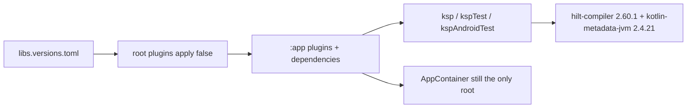

# Phase 1: Toolchain

## Goal

Put Hilt 2.60.1, its KSP compilers, and `hilt-lifecycle-viewmodel-compose` 1.4.0 on the classpath so later phases can annotate types, while `AppContainer` remains the only composition root.

## Context links

- [researcher-01-hilt-toolchain.md](./research/researcher-01-hilt-toolchain.md) sections 1–4 and 8–9 (versions, plugin id, metadata pin, catalog).
- [researcher-02-hilt-migration-patterns.md](./research/researcher-02-hilt-migration-patterns.md) "Phased migration" item 1. This phase stops at the compilers. It does not add `@HiltAndroidApp`.
- [scout-manual-di.md](./research/scout-manual-di.md) section 9: `main` has no `javax.inject`, `dagger`, or `hilt` imports today.
- Gradle shape: `gradle/libs.versions.toml`, root `build.gradle.kts` plugins, `app/build.gradle.kts` plugins (lines 9–18) and dependencies (lines 350–370).

## Key Insights

- Plugin id is `com.google.dagger.hilt.android` version 2.60.1. Apply it with `apply false` at the root, next to KSP, and apply it on `:app` only. Do not apply `org.jetbrains.kotlin.android`. AGP 9.4.1 already compiles Kotlin (`app/build.gradle.kts` lines 10–11).
- `hilt-compiler` 2.60.1 does not shade `kotlin-metadata-jvm`. Its POM depends on metadata 2.3.21, which cannot read this app's Kotlin 2.4 metadata. Add `org.jetbrains.kotlin:kotlin-metadata-jvm:2.4.21` on `ksp`, `kspTest`, and `kspAndroidTest` beside `hilt-compiler`. Those three configurations do not extend each other. Keep the pin if the first compile succeeds without needing it. Do not use `2.5.0-Beta2`.
- `androidx.hilt:hilt-lifecycle-viewmodel-compose:1.4.0` is the Compose / Navigation 3 artifact. Do not add `androidx.hilt:hilt-navigation-compose` (it pulls Navigation 2). Do not add `androidx.hilt:hilt-compiler` (WorkManager) or a direct `dagger` / `dagger-compiler` dependency.
- KSP stays `2.3.12` (`gradle/libs.versions.toml` line 7). Do not add kapt or `legacy-kapt`. Do not set `android.disallowKotlinSourceSets=false`. Do not set plugin-owned Hilt flags (`enableAggregatingTask` stays default).
- `AppContainer` (`AppContainer.kt` line 117) stays the only root. No `@HiltAndroidApp`, no `@Module`, no `@AndroidEntryPoint`.

## Requirements

- Catalog, root plugin, `:app` plugin, runtime, testing, and the three KSP configurations match the coordinates in the toolchain report section 9.
- `javax.inject` is the inject API later phases will use. Do not add `jakarta.inject` as a direct dependency.
- README commands stay on `--no-configuration-cache` (`README.md` lines 38–42). `gradle.properties` keeps `org.gradle.configuration-cache=true`. Turning the cache on is not a goal.
- One diagnostic pair may run with `--configuration-cache`. Record whether the second run reuses the entry. A cache miss does not fail this phase and does not change the README.

## Architecture

No runtime graph changes. Gradle resolves Hilt and the metadata jar onto the KSP classpaths. `SkimApplication.onCreate` still assigns `AppContainer(this)` (`SkimApplication.kt` lines 11–15).



## Related Code Files

- Modify: `gradle/libs.versions.toml` — versions, libraries, and the Hilt plugin alias.
- Modify: `build.gradle.kts` — `alias(libs.plugins.hilt) apply false`.
- Modify: `app/build.gradle.kts` — apply the plugin beside KSP (lines 9–18); add the dependencies beside the existing `implementation` and test blocks (lines 350–370).
- Create: none.
- Delete: none.

Do not modify `SkimApplication.kt`, `AppContainer.kt`, `README.md`, `robolectric.properties`, or any test.

## Implementation Steps

1. In `gradle/libs.versions.toml`, add `hilt = "2.60.1"`, `hiltLifecycleViewmodelCompose = "1.4.0"`, and `kotlinMetadata = "2.4.21"` with the catalog's `MC` / `GM` comment style. Add libraries `hilt-android`, `hilt-compiler`, `hilt-android-testing`, `androidx-hilt-lifecycle-viewmodel-compose`, and `kotlin-metadata-jvm`. Add plugin `hilt` with id `com.google.dagger.hilt.android`.
2. In the root `plugins` block, add `alias(libs.plugins.hilt) apply false`. Do not add `org.jetbrains.kotlin.android`.
3. In `:app` `plugins`, add `alias(libs.plugins.hilt)` next to `alias(libs.plugins.ksp)`.
4. Add dependencies:

```kotlin
implementation(libs.hilt.android)
implementation(libs.androidx.hilt.lifecycle.viewmodel.compose)
ksp(libs.hilt.compiler)
ksp(libs.kotlin.metadata.jvm)
testImplementation(libs.hilt.android.testing)
kspTest(libs.hilt.compiler)
kspTest(libs.kotlin.metadata.jvm)
androidTestImplementation(libs.hilt.android.testing)
kspAndroidTest(libs.hilt.compiler)
kspAndroidTest(libs.kotlin.metadata.jvm)
```

5. Do not add `@HiltAndroidApp`, modules, or a custom test runner. Leave `testInstrumentationRunner` (`app/build.gradle.kts` line 52) on `androidx.test.runner.AndroidJUnitRunner`.
6. Run the verification commands. If `:app:hiltJavaCompileDebug` reports a metadata maximum of 2.3.0, the pin in step 4 is the fix and it is already present; stop and report any other compiler error. If the compile succeeds, leave the pin in place.

## Todo

- [x] Add the version catalog entries and plugin alias.
- [x] Apply the Hilt plugin at the root (`apply false`) and on `:app`.
- [x] Add runtime, Compose ViewModel, testing, and `ksp` / `kspTest` / `kspAndroidTest` dependencies, including `kotlin-metadata-jvm:2.4.21`.
- [x] Confirm `AppContainer` is still the only root and `org.jetbrains.kotlin.android` is absent.
- [x] Run the Gradle gate and record the configuration-cache pair.

## Success Criteria

- `:app:assembleDebug` and `:app:testDebugUnitTest` pass with `--no-configuration-cache`.
- `app/build.gradle.kts` applies `com.google.dagger.hilt.android` and does not apply `org.jetbrains.kotlin.android`.
- The three KSP configurations both have `hilt-compiler:2.60.1` and `kotlin-metadata-jvm:2.4.21`.
- No source file under `app/src/main` imports `dagger`, `hilt`, or `javax.inject` yet.
- `SkimApplication.onCreate` still constructs `AppContainer`.

## Risk Assessment

- Metadata mismatch. Signal: `hiltJavaCompile` fails with "maximum supported version is 2.3.0". Response: the 2.4.21 pin stays on every KSP configuration that has `hilt-compiler`. Do not move to `2.5.0-Beta2` and do not downgrade Kotlin.
- Configuration cache rejects a Hilt or KSP task. Signal: the second `--configuration-cache` run does not print `Reusing configuration cache`, or the task fails. Response: record the Gradle line. Keep README on `--no-configuration-cache`. Do not change `gradle.properties`.
- Built-in Kotlin source set failure. Signal: KSP cannot write generated sources and the log mentions `kotlin.sourceSets`. Response: do not set `android.disallowKotlinSourceSets=false`. Stop if KSP 2.3.12 cannot generate. Room already uses this KSP.
- Unused Hilt artifacts fail lint or the build. Signal: a new warning treated as an error names `hilt-android` or the Compose artifact. Response: keep the dependencies; they are required by phases 2 and 3. Do not add `hilt-navigation-compose` to "use" the Compose artifact.

## Security Considerations

This phase adds build tooling only. Do not read or log the local API credential, and do not add a `BuildConfig` field. Release still sets the release credential field to null in `app/build.gradle.kts` lines 66–69.

## Verification

Gate:

```bash
./gradlew :app:assembleDebug :app:testDebugUnitTest --no-configuration-cache
```

Diagnostic pair (record the result, do not treat a cache miss as a phase failure):

```bash
./gradlew :app:assembleDebug :app:testDebugUnitTest --configuration-cache
./gradlew :app:assembleDebug :app:testDebugUnitTest --configuration-cache
```

Do not run connected tests. This environment has no system image.

## Next Steps

Phase 2 adds `@HiltAndroidApp`, the singleton generation, and the test runner. It depends on this classpath.
