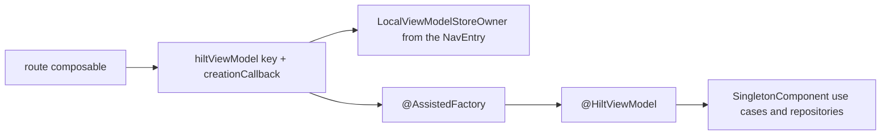

# Phase 3: ViewModels

## Goal

Construct all 23 ViewModels with `@HiltViewModel`, pass navigation arguments with `@Assisted` and `creationCallback`, and keep unit tests on the public constructor.

## Context links

- [researcher-01-hilt-toolchain.md](./research/researcher-01-hilt-toolchain.md) sections 4–5: `hiltViewModel` package, `key`, `creationCallback`, `javax.inject.Inject`.
- [researcher-02-hilt-migration-patterns.md](./research/researcher-02-hilt-migration-patterns.md): Navigation 3 does not fill `SavedStateHandle`; keep string keys; unit tests call the constructor.
- [scout-manual-di.md](./research/scout-manual-di.md) section 5: 23 classes and 24 `viewModel` sites. `TabsViewModel` has two.
- Keys verified in source: `BrowsingRoute.kt` lines 48 and 109 (`browsing`), `NewTabPageRoute.kt` lines 82 and 139 (`home`), `SearchOverlay.kt` lines 84 and 398 (`search`).
- Route tests that render screens: `NewTabPageRouteTest.kt` lines 125–154, `BrowsingRouteTest.kt` lines 134–168.

## Key Insights

- `hiltViewModel` is `androidx.hilt.lifecycle.viewmodel.compose.hiltViewModel`. It takes a `ViewModelStoreOwner` (default `LocalViewModelStoreOwner`) and an optional `key`. The assisted overload takes `creationCallback`. Do not import `androidx.hilt.navigation.compose`.
- Navigation 3 does not put `tabId`, `folderId`, `bookmarkId`, `shortcutId`, `incognito`, `AskPageKey`, `AskTabsKey`, or `HitTarget` into `SavedStateHandle`. Those stay `@Assisted`. `SavedStateHandle` remains an ordinary parameter on `AskPageViewModel` (line 120) and `AskTabsViewModel` (line 97); Hilt provides it. Delete `createSavedStateHandle()` at the call sites.
- One `BrowserKey` entry hosts many `BrowsingViewModel`s. The key stays `"$BROWSING_VIEW_MODEL_KEY:${tab.id}"` (`BrowsingRoute.kt` line 48), which is `browsing:<tabId>`. Keep every other existing key string. `RenameGroupRoute` uses `viewModel { }` with no key (`RenameGroupDialog.kt` line 29). Leave that key unset.
- `TabsViewModel.attachGrouping` returns immediately when `grouper` is null (`TabsViewModel.kt` lines 116–118). The tabs screen passes the grouper. `RenameGroupRoute` passes `grouper = null` and `incognito = false`. Assisted parameters preserve that. Do not inject `TabGrouping` into the constructor, or the rename dialog would attach it. Injecting `@AppScope` into both call sites does not start grouping when `grouper` is null.
- Kotlin default parameters are invisible to Dagger. Every parameter Hilt supplies needs a binding. Annotate each process `CoroutineScope` with `@AppScope`. Do not leave those parameters unqualified: phase 2's scope binding is qualified, and an unqualified `CoroutineScope` (`AskPageViewModel.kt` line 121, `AskTabsViewModel.kt` line 98, `HomeViewModel.kt` line 87, `ReaderViewModel.kt` line 47, `SetupViewModel.kt` line 38, `ShortcutDialogViewModel.kt` line 53, `ClearBrowsingDataViewModel.kt` line 15, `DeleteAiDataViewModel.kt` line 11, `ClearSkimHistoryViewModel.kt` line 15) will not match it. `TabsViewModel.appScope` stays `CoroutineScope? = null` (`TabsViewModel.kt` line 87). `TabsViewModelTest.model` already passes that argument and defaults it to null (lines 277–289), so omitting it in a test still means "do not launch." Give that parameter `@AppScope` as well. One `@Provides @AppScope fun appScope(): CoroutineScope` feeds the non-null parameters. If the processor treats `CoroutineScope?` as a different key, add a second qualified provider that returns the same instance as `CoroutineScope?`. Do not delete the `= null` default. <!-- Updated: Red Team - qualified scope, nullable tabs scope kept -->
- `@AndroidEntryPoint` has to be on `MainActivity` in this phase. `hiltViewModel` resolves its factory from `LocalContext`, and phase 3 changes the route call sites. The activity does not `@Inject BrowserHost` yet. `createBrowserHost` (`MainActivity.kt` line 83) remains the only pool. Phase 4 adds the activity-scoped injection on this same annotation.
- `SearchViewModel` (`SearchViewModel.kt` lines 76–81) takes `Flow<SearchEngine>` and a function. Keep that constructor. It is what `SearchViewModelTest.search()` (line 498) and the real-service call (line 478) use. Add a second constructor marked `@Inject` that takes `domain.settings.SettingsRepository` and `search.SuggestionService`, plus the existing match use cases, and delegates to the test constructor with `settings.settings.map { it.searchEngine }` and `suggestionService::suggestions`. Do not rewrite the test onto `FakeSettingsRepository` or an OkHttp interceptor. `ui` may import `search`. `ui` must not import `data`. `SuggestionService` is `com.dantech.skimbrowser.search` (`SuggestionService.kt` line 1). <!-- Updated: Red Team - keep the test constructor -->

## Requirements

- All 24 production `viewModel` sites call `hiltViewModel`. No production `viewModel { ViewModel(...) }` factory remains.
- Assisted ids use the existing key strings. No id is read from `SavedStateHandle`.
- `@Inject` / `@AssistedInject` constructors stay public. ViewModel unit tests keep calling them with fakes. They do not get `@HiltAndroidTest`.
- `NewTabPageRouteTest` and `BrowsingRouteTest` gain a Hilt `ViewModelStoreOwner` once the route calls `hiltViewModel`. `BrowsingRouteTest` still calls `createBrowserHost` and attaches `FakeTabEngine` (lines 148–150).
- `SearchViewModelTest` is unchanged. The class keeps calling the flow-and-function constructor.
- Add the clock, zone, dispatcher, voice, version, and default-browser bindings in this phase. Keep Kotlin defaults on parameters unit tests omit. Hilt bindings cover the same parameters when Hilt calls the constructor. If `@AssistedInject` rejects a default, keep the public constructor with the default and have the assisted factory call it. Do not drop `TabsViewModel`'s `appScope = null`.
- Do not expand `BROWSER_WIRING` (`DomainBoundaryTest.kt` lines 145–155).

## Architecture

`@HiltViewModel` classes are created by `ViewModelProvider` inside the `NavEntry` store that `rememberViewModelStoreNavEntryDecorator` already installs. `creationCallback` runs when the store has no instance for that key. A later composition with the same key keeps the instance and ignores a new callback.



`MainActivity` is `@AndroidEntryPoint` and extends `ComponentActivity` (`MainActivity.kt` line 47). Member injection from the generated superclass runs during `super.onCreate()`, after `enableEdgeToEdge()` (line 78). Do not move `enableEdgeToEdge()` to after `super.onCreate()`. Do not `@Inject` the pool in this phase.

### Assisted arguments

| ViewModel | File | Assisted | Store key |
|---|---|---|---|
| `AskPageViewModel` | `ui/ai/AskPageViewModel.kt` 110 | `AskPageKey` | `ask-${tabId}-${savedChatId}-${fromReader}` (`AskPageRoute.kt` 27) |
| `AiPermissionViewModel` | `ui/ai/AiPermissionViewModel.kt` 10 | none | `allow-${tabId}` (`AskPageRoute.kt` 85) |
| `AskTabsViewModel` | `ui/ai/AskTabsViewModel.kt` 90 | `AskTabsKey` | `ask-tabs-${prompt}-${savedChatId}` (`AskTabsSheet.kt` 84) |
| `BookmarksViewModel` | `ui/bookmarks/BookmarksViewModel.kt` 82 | `Long?` folderId | `bookmarks-${folderId}` (`BookmarksScreen.kt` 54) |
| `BrowsingViewModel` | `ui/browsing/BrowsingViewModel.kt` 95 | `String` tabId | `browsing:<tabId>` (`BrowsingRoute.kt` 48) |
| `LinkOptionsViewModel` | `ui/browsing/LinkOptionsSheet.kt` 128 | tabId, `HitTarget` | `link-options:${tabId}:${target}` (line 173) |
| `ReaderViewModel` | `ui/reader/ReaderViewModel.kt` 41 | tabId | `reader-${tabId}` (`ReaderRoute.kt` 28) |
| `TabsViewModel` | `ui/tabs/TabsViewModel.kt` 80 | incognito, grouping flow, `TabGrouper?` | `tabs-${incognito}` (`TabsScreen.kt` 109); rename has no key |
| `EditBookmarkViewModel` | `ui/bookmarks/BookmarkDialogs.kt` 115 | bookmarkId | none (line 254) |
| `MoveToFolderViewModel` | same file 195 | bookmarkId | none (line 267) |
| `MoreMenuViewModel` | `ui/browsing/MoreMenuSheet.kt` 103 | tabId | none (line 206) |
| `ShortcutDialogViewModel` | `ui/home/ShortcutDialogViewModel.kt` 48 | `Long?` shortcutId | none (`ShortcutDialog.kt` 40) |
| `SiteInfoViewModel` | `ui/browsing/SiteInfoSheet.kt` 111 | tabId | none (line 242) |

No assisted arguments, and no store key, unless noted: `HomeViewModel` (`NewTabPageRoute.kt` line 82, key `home`), `SearchViewModel` (key `search`), `AiPrivacyViewModel` (`AiPrivacyScreen.kt` 41), `ClearBrowsingDataViewModel` (`SettingsScreen.kt` 124), `DeleteAiDataViewModel` (`AiPrivacyScreen.kt` 66), `ClearSkimHistoryViewModel` (`ClearSkimHistoryDialog.kt` 35), `HistoryViewModel` (`HistoryScreen.kt` 50), `SettingsViewModel` (`SettingsScreen.kt` 50), `SetupViewModel` (`SetupScreen.kt` 152), `SkimHistoryViewModel` (`SkimHistoryScreen.kt` 53).

`TabsViewModel` factory:

```kotlin
@HiltViewModel(assistedFactory = TabsViewModel.Factory::class)
class TabsViewModel @AssistedInject constructor(
    @Assisted private val incognito: Boolean,
    private val tabs: TabsController,
    private val snackbar: SnackbarController,
    private val undo: UndoRegistry,
    @Assisted grouping: Flow<GroupingBannerState?> = flowOf(null),
    @Assisted private val grouper: TabGrouper? = null,
    @AppScope private val appScope: CoroutineScope? = null,
    @MainImmediate private val mainDispatcher: CoroutineDispatcher = Dispatchers.Main.immediate,
) : ViewModel()
```

`TabsViewModelTest.model` keeps passing `appScope = null` by default. If the processor rejects those defaults on `@AssistedInject`, leave this public constructor as it is and move the Hilt annotations to a factory that calls it. Do not make `appScope` non-null.

```kotlin
@AssistedFactory
interface Factory {
    fun create(
        incognito: Boolean,
        grouping: Flow<GroupingBannerState?>,
        grouper: TabGrouper?,
    ): TabsViewModel
}
```

<!-- Updated: Red Team - nullable appScope stays -->

Tabs screen: `creationCallback` passes `key.incognito`, the existing banner flow, and the grouper, with key `tabs-${key.incognito}`. Rename: `hiltViewModel` with no key and `creationCallback` passing `incognito = false`, `flowOf(null)`, and `grouper = null`.

### Bindings Hilt cannot see as defaults

| Parameter | Call sites today | Binding |
|---|---|---|
| `() -> Long` clock | `HomeViewModel.kt` 89, `HistoryViewModel.kt` 57, `SkimHistoryViewModel.kt` 67 | `@WallClock` `@Provides` `System::currentTimeMillis` |
| `() -> ZoneId` | `HomeViewModel.kt` 90 | `@WallZone` `@Provides` `ZoneId::systemDefault` |
| `ZoneId` | `HistoryViewModel.kt` 58, `SkimHistoryViewModel.kt` 68 | `@Provides ZoneId.systemDefault()` |
| `CoroutineDispatcher` | `TabsViewModel.kt` 88 | `@MainImmediate` `Dispatchers.Main.immediate` |
| `Boolean` voice | `HomeViewModel.kt` 88, from `VoiceInput.isAvailable` | `@VoiceAvailable` calling `VoiceInput.isAvailable(app)` (`VoiceInput.kt` 26) |
| version name and code | `SettingsViewModel.kt` 38–39 | `AppVersion(name, code)` from `BuildConfig.VERSION_NAME` and `VERSION_CODE` |
| `() -> Boolean` default browser | `SetupViewModel.kt` 34 | `@DefaultBrowserCheck` `{ DefaultBrowser.isDefault(app) }` (`DefaultBrowser.kt` 21) |

`Application` context is enough for `RoleManager` and `PackageManager`. Put qualifiers and `AppVersion` in `di/`. `SettingsViewModel` takes `AppVersion` and still publishes `versionName` and `versionCode` on `SettingsUiState`. Update `SettingsViewModelTest` to pass `AppVersion`.

`SearchViewModel` keeps the constructor tests already call. The Hilt constructor delegates to it:

```kotlin
@HiltViewModel
class SearchViewModel @Inject constructor(
    settings: SettingsRepository,
    suggestionService: SuggestionService,
    matchHistory: MatchHistory,
    matchBookmarks: MatchBookmarks,
) : this(
    settings.settings.map { it.searchEngine },
    suggestionService::suggestions,
    matchHistory,
    matchBookmarks,
)
```

`searchViewModel` (`SearchOverlay.kt` lines 84–90) becomes `hiltViewModel(key = SEARCH_VIEW_MODEL_KEY)` and takes no container. `SearchViewModelTest` is not edited.

### Route tests

`hiltViewModel()` reads `LocalContext` for the Hilt factory and `LocalViewModelStoreOwner` for the store. Add `@AndroidEntryPoint class HiltRouteActivity : ComponentActivity()` under `app/src/test`. It has no `@Inject BrowserHost` in this phase. `NewTabPageRouteTest` and `BrowsingRouteTest` already use `@Config(qualifiers = PHONE_QUALIFIERS)` (`NewTabPageRouteTest.kt` line 110, `BrowsingRouteTest.kt` line 100) and `createAndroidComposeRule<ComponentActivity>()` (`NewTabPageRouteTest.kt` line 117). Merge the config to `application = HiltTestApplication::class` plus those qualifiers. Do not replace the qualifiers. Set `HiltAndroidRule` to order 0 and the compose rule to a higher order so the activity is not launched first. Change the compose rule's activity to `HiltRouteActivity`. Keep the test's `destination` store (`NewTabPageRouteTest.kt` lines 125–128) by providing `LocalViewModelStoreOwner`. Calls to `searchViewModel(container)` (`NewTabPageRouteTest.kt` lines 276–277 and 513–517, `BrowsingRouteTest.kt` lines 413–415) become `hiltViewModel(key = SEARCH_VIEW_MODEL_KEY)`. Set `TestStorage` before the activity is used. If Robolectric reports the activity missing from the manifest, register it from `app/src/test` or `src/debug` only, not from the release manifest. <!-- Updated: Red Team - rule order and merged @Config -->

Other ViewModel unit tests stay on `ViewModel(...)` with fakes. `@AssistedInject` does not hide the constructor; the test passes the assisted value itself and does not use the factory.

## Related Code Files

Create:

- `app/src/main/java/com/dantech/skimbrowser/di/AppVersion.kt`
- `app/src/main/java/com/dantech/skimbrowser/di/ViewModelBindingsModule.kt` — clock, zone, dispatcher, voice, version, default-browser check.
- `app/src/test/java/com/dantech/skimbrowser/HiltRouteActivity.kt`

Modify the 23 ViewModels listed above, the 24 call sites, `MainActivity.kt` (annotation only), `SettingsViewModelTest.kt`, `NewTabPageRouteTest.kt`, and `BrowsingRouteTest.kt`. Do not modify `SearchViewModelTest.kt`.

Delete: none.

Do not modify `createBrowserHost`, `WebViewPool`, or `BROWSER_WIRING`. Do not delete `AppContainer`.

## Implementation Steps

1. Add `AppVersion` and `ViewModelBindingsModule` with the qualifiers from the table. Use `javax.inject.Inject` and `javax.inject.Qualifier`.
2. Annotate each ViewModel. Assisted types use `@HiltViewModel(assistedFactory = ...)`, `@AssistedInject`, `@Assisted`, and a factory interface with one `create` method. Others use `@HiltViewModel` and `@Inject constructor`. Leave `SavedStateHandle` unqualified on the two ask ViewModels.
3. Replace each call site with `hiltViewModel`, keeping the key strings in the table. Rename passes a null grouper and does not set a key.
4. Add the `@Inject` constructor on `SearchViewModel` that delegates to the existing constructor. `SearchOverlay.searchViewModel` becomes `hiltViewModel`. Leave `SearchViewModelTest` as it is.
5. Change `SettingsViewModel` to `AppVersion`. Update its unit test.
6. Annotate `MainActivity` with `@AndroidEntryPoint`. Do not inject `BrowserHost`. Leave `enableEdgeToEdge()` before `super.onCreate()` and leave `createBrowserHost` at line 83.
7. Move `NewTabPageRouteTest` and `BrowsingRouteTest` onto `HiltRouteActivity` and the Hilt rule. Keep `createBrowserHost` in `BrowsingRouteTest`.
8. Search `app/src/main` for `viewModel {` and `viewModel(`. Remaining hits are `hiltViewModel` only.

## Todo

- [x] Add `AppVersion` and the qualified clock, zone, dispatcher, voice, and default-browser bindings.
- [x] Annotate all 23 ViewModels. Assisted nav args use the existing keys.
- [x] Give `TabsViewModel` two `creationCallback`s. Rename passes `grouper = null`.
- [x] Change `SearchViewModel` by adding an `@Inject` constructor that delegates to the existing one. Do not edit `SearchViewModelTest`.
- [x] Annotate `MainActivity` without injecting the pool.
- [x] Point the two route tests at `HiltRouteActivity`.
- [x] Leave other ViewModel unit tests on the public constructor.

## Success Criteria

- `:app:assembleDebug` and `:app:testDebugUnitTest` pass with `--no-configuration-cache`.
- Production call sites use `androidx.hilt.lifecycle.viewmodel.compose.hiltViewModel`. The browsing key is still `browsing:<tabId>`.
- `RenameGroupDialog` does not pass a `TabGrouper`.
- `SearchViewModel` still has the flow-and-function constructor. `ui/search` does not import `com.dantech.skimbrowser.data`. `SearchViewModelTest` is unchanged.
- No ViewModel unit test is annotated `@HiltAndroidTest`.
- `createBrowserHost` is still the only `WebViewPool` construction in `main` and in `BrowsingRouteTest`.
- `BROWSER_WIRING` is unchanged.

## Risk Assessment

- One browsing ViewModel for every tab. Signal: tab switches show another tab's address or navigation state. Response: put the assisted `hiltViewModel` key back to `browsing:<tabId>`. Do not rely on `NavEntry.contentKey` alone.
- Rename starts grouping. Signal: `TabsViewModelTest` or the rename UI starts a grouper, or the factory has no null `grouper` parameter. Response: restore the assisted null. Do not inject `TabGrouping` into `TabsViewModel`.
- Assisted value read from `SavedStateHandle`. Signal: a ViewModel reads `tabId` or `folderId` from the handle, or a test of process death shows an empty id after the back stack itself restored. Response: pass the id only through `creationCallback`. The restored `NavKey` is what the new callback receives.
- Missing binding for a defaulted parameter. Signal: Hilt fails with a missing binding for `() -> Long`, `ZoneId`, `Boolean`, `String`, `Int`, or `CoroutineDispatcher`. Response: add the qualified binding or `AppVersion`. Do not add an unqualified `String` or `Int` binding. Do not delete the Kotlin default that unit tests omit.
- Route test has no Hilt factory. Signal: `hiltViewModel` throws because `LocalContext` is not an entry point, or no `ViewModelStoreOwner` is set. Response: host the composition in `HiltRouteActivity` and provide the existing `destination` store. Do not put `HiltTestApplication` in `robolectric.properties`.
- Second pool. Signal: `BrowsingRouteTest` or `MainActivity` builds a Hilt `WebViewPool` and also calls `createBrowserHost`. Response: remove the Hilt pool. Activity scope is phase 4.
- `SearchViewModel` tests lose the scripted engine. Signal: `SearchViewModelTest` no longer compiles, or cancellation tests hit the network. Response: restore the flow-and-function constructor and point the `@Inject` constructor at it. Do not drive those tests through `SuggestionService`.

## Security Considerations

`AppVersion` exposes the version name and code the settings screen already shows. It does not include the API credential. Voice and default-browser checks use `Application` and do not store the result beyond the ViewModel. Do not log omnibox text from the new `SearchViewModel` constructor; `SuggestionService` already refuses to log queries (`SuggestionService.kt` lines 26–28).

## Verification

```bash
./gradlew :app:assembleDebug :app:testDebugUnitTest --no-configuration-cache
```

Search checks:

- `rg "androidx.hilt.navigation" app/src` is empty.
- `rg "createSavedStateHandle" app/src/main` is empty.
- `rg "viewModel\\(" app/src/main` matches only `hiltViewModel`.
- `BrowsingRoute.kt` still contains `BROWSING_VIEW_MODEL_KEY`.

Do not require `:app:assembleDebugAndroidTest` again unless a main signature change breaks the androidTest compile. Route signatures still take the facade, so they should not. If they do, fix the compile in this phase.

## Next Steps

Phase 4 moves `BrowserHost` to `@ActivityScoped`, deletes `createBrowserHost` and the facade, and updates the boundary test and docs.
