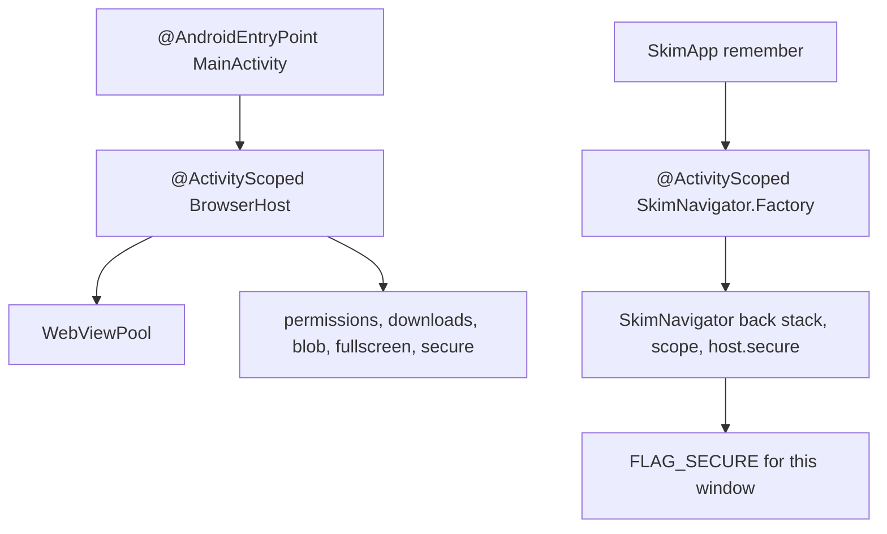

# Phase 4: Activity graph

## Goal

Give `BrowserHost` and the objects `createBrowserHost` builds an `@ActivityScoped` lifetime, build `SkimNavigator` from an activity-scoped assisted factory, and delete `AppContainer` so Hilt is the only composition root.

## Context links

- [researcher-02-hilt-migration-patterns.md](./research/researcher-02-hilt-migration-patterns.md): why the pool is `@ActivityScoped`, why it is not retained or `@Singleton`, and why the navigator is an assisted factory. The report's separate "delete the container" phase is this phase.
- [researcher-01-hilt-toolchain.md](./research/researcher-01-hilt-toolchain.md) section 7: do not add `-keep class **.Hilt_*` unless `EntryPoints` throws `ClassCastException`. Consumer rules in hilt-android 2.60.1 do not contain that keep. PR 5195 is open.
- [scout-manual-di.md](./research/scout-manual-di.md) sections 4 and 10: `createBrowserHost` (`MainActivity.kt` lines 162–196), `BrowserHost.kt` lines 16–37, `SkimNavigator.kt` lines 34–42, `SkimApp.kt` lines 81–92, and the docs that name the container.
- Manifest: `AndroidManifest.xml` lines 59–60. `configChanges` includes orientation, screen size, uiMode, density, font scale, locale, and `fontWeightAdjustment`. `MainActivity` lines 35–36 say those changes do not recreate the activity.
- Kover: `app/build.gradle.kts` lines 372–385. Keep rules: `app/src/main/keepRules/rules.keep`.
- Boundary filename skip: `DomainBoundaryTest.kt` lines 34–38. Synthetic root path: line 94.

## Key Insights

- `ActivityComponent` binds `Activity`, not `ComponentActivity`. `MainActivity` extends `ComponentActivity` (`MainActivity.kt` line 47). Provide `ComponentActivity` with `activity as ComponentActivity` in a module installed in `ActivityComponent`.
- `@ActivityScoped` covers `BrowserHost` and what `createBrowserHost` builds: `WebViewPool`, `SitePermissionBridge`, `BlobBridge`, `DownloadRouter`, `FullscreenController`, `WindowSecureController`, plus `ActivityResultHost` (`MainActivity.kt` line 82). `PageScripts` stays the process binding from phase 2 (`AppContainer.kt` line 250). It is not built by `createBrowserHost`. Do not use `@ActivityRetainedScoped` or a custom component. Do not `@Singleton` the pool or the navigator. The pool's constructor takes the `Activity` (`WebViewPool.kt` line 62).
- There is one `WindowSecureController` per activity. `BrowserHost` stores that instance. The navigator factory and `SecureFlagEffect` receive the same instance. `remember` keys include `host.secure` as well as `backStack` and `scope` (`SkimApp.kt` lines 81–92). A second controller whose owner set becomes empty clears `FLAG_SECURE` (`WindowSecureController.kt` lines 46–54) while the other still has an owner. <!-- Updated: Red Team - one secure controller -->
- Hilt does not call `BrowserHost.destroy()` (`BrowserHost.kt` lines 32–36). That method must also call `ActivityResultHost.destroy()` (`ActivityHost.kt` lines 102–106); today `MainActivity.onDestroy` calls them separately (lines 140–141). After the field is deleted, one `browserHost.destroy()` covers both. `MainActivity.onDestroy` still calls it, then `tabManager.detach` (lines 134–144).
- `SkimNavigator` is not an `@ActivityScoped` constructor. Inject an `@ActivityScoped` `@AssistedFactory`. `remember` still passes `NavBackStack`, `rememberCoroutineScope()`, and `host.secure`. Tabs, incognito, snackbar, and `AskPageAccess` are constructor-injected. The first navigator must not outlive the window's `FLAG_SECURE` controller.
- `WebViewPool`'s defaulted parameters (`WebViewPool.kt` lines 71–76), `DownloadRouter`'s (`DownloadRouter.kt` lines 78–82), and `SitePermissionBridge`'s (`SitePermissionBridge.kt` line 79) are invisible to an `@Inject` constructor. A `@Provides` method in `browser/` calls each constructor and omits `isLowRamDevice`, timers, thumbnail, cookie lambda, dispatchers, and clocks so those defaults stay. Pass `@MainImmediate` only where `createBrowserHost` would have passed a dispatcher explicitly. It does not. `WindowSecureController` and `BlobBridge` have internal constructors. Call them from `@Provides` in the same package. Do not `@Inject` an `internal` constructor; the generated component is another package. There is one `@Provides` for `WindowSecureController`, and the host provider takes that binding. It does not call `WindowSecureController(activity)` again.
- `InProcessDownloader` is given `{ container.httpClient }` today (`MainActivity.kt` line 179), so building the host does not open OkHttp. The activity provider takes the generation's HTTP getter and wraps it in that lambda. It does not call the getter while building the router.
- Phase 3 already put `@AndroidEntryPoint` on `MainActivity`. This phase adds `@Inject lateinit var browserHost: BrowserHost` and deletes `createBrowserHost`. One pool.
- `ui` must not gain imports of `data` or `ai`. `TabsController` is what `ui` sees, not `TabManager`, except files already in `BROWSER_WIRING`. Do not expand that set. `BrowserRoute.kt` is not in it (`DomainBoundaryTest.kt` lines 145–155). `ui/browsing/BrowsingRoute.kt` is. An entry point that `ui` imports must not live under `browser`, `data`, or `ai`: the boundary test matches the package string (`DomainBoundaryTest.kt` lines 163–169). Put shell entry points in `com.dantech.skimbrowser.di`. `ShellEntryPoint` returns only the domain types and controllers a route still reads after phase 3. It does not return `ClaudeClientProvider`, `OkHttpClient`, `DataStore`, `SkimDatabase`, or `SettingsRepository` unless a route still calls a method that is not on a ViewModel. Prefer the ViewModel. <!-- Updated: Red Team - BrowserRoute is not allowlisted; narrow entry point -->
- When `AppContainer.kt` is deleted, remove `file.name != "AppContainer.kt"` (`DomainBoundaryTest.kt` line 38). Retarget the synthetic assertion at line 94 from `AppContainer.kt` to `SkimApplication.kt`. The chat-repository check from phase 2 still flags the concrete class outside `data/`, including a fully qualified name. The provider under `data/di` still satisfies it.

## Requirements

- `MainActivity` injects one `BrowserHost`, provides `LocalBrowserHost`, attaches the pool, and destroys the host in `onDestroy`.
- `SkimNavigator(...)` in `SkimApp` is replaced by the factory inside the same `remember`. No second construction site and no `@Singleton` navigator.
- Every `AppContainer` parameter is gone. `rg AppContainer app/src` finds nothing in `main`, `test`, or `androidTest`.
- `BrowserRig` and `BrowsingRouteTest` stop calling `createBrowserHost`. They set `TestStorage` before the Hilt activity is launched so the process opens one Room database.
- Kover excludes `Hilt_*`, `*_Factory`, `*_MembersInjector`, and `*_HiltModules*` the same way it excludes `*Dao_Impl` (`app/build.gradle.kts` lines 377–381). Do not exclude composables.
- Docs that describe the container are updated in this phase, including `docs/project-roadmap.md` line 34, which says `AppContainer` wires the use cases. Do not edit historical files under `plans/261020-1611-skim-design-implementation/`.
- Do not add the `Hilt_*` keep rule in `rules.keep` as part of the first release assemble. Add it only if a runtime `EntryPoints.get` throws `ClassCastException`. This environment cannot run that process; assemble does not execute the cast.

## Architecture

`@AndroidEntryPoint MainActivity` receives `BrowserHost` during `super.onCreate()`. `enableEdgeToEdge()` stays before that call (`MainActivity.kt` lines 78–79). Result launchers register inside `ActivityResultHost` while `onCreate` is still running, before `onStart`. After `super.onCreate()`, the activity attaches `browserHost.pool` to `TabManager`, posts `incognitoSession.purgeStale()`, and `setContent` provides `LocalBrowserHost`.



`ComponentActivity` module:

```kotlin
@Module
@InstallIn(ActivityComponent::class)
object ActivityTypeModule {
    @Provides
    fun componentActivity(activity: Activity): ComponentActivity = activity as ComponentActivity
}
```

The activity graph module in `browser/` `@Provides` `@ActivityScoped` `BrowserHost` by calling the same constructors `createBrowserHost` calls, in the same order (`MainActivity.kt` lines 163–196), except `WindowSecureController` and `ActivityHost` are parameters, not `new` expressions inside the host provider. `WebViewPool` stays `@MainThread`. The provider runs when the activity first injects the host, which is on the main thread during `onCreate`. Hilt's context listener can run that injection earlier than today's `ActivityResultHost(this)` after `super.onCreate()` (`MainActivity.kt` lines 77–83). Registration must still happen before the lifecycle is `STARTED` (`ActivityResultRegistry` rejects a later call). If a test shows the launcher registered too early to restore a result, move `ActivityResultHost` construction to just after `super.onCreate()` returns and pass that instance into the host. Do not leave two hosts.

`androidTest` replaces `ActivityHost` with `@TestInstallIn` of `TestActivityHost` (`BrowserRig.kt` line 281). `ExternalLinksTest` and `SharedDownloadsFolderDeviceTest` assert on that fake. The production module's `ActivityResultHost` must not be the one those tests observe.

Navigator:

```kotlin
@AssistedFactory
interface Factory {
    fun create(
        backStack: NavBackStack<NavKey>,
        secure: WindowPrivacy,
        scope: CoroutineScope,
    ): SkimNavigator
}
```

Install the factory in `ActivityComponent`. `SkimApp` obtains the navigator factory with `EntryPoints.get` on the activity `LocalContext`, which is the `@AndroidEntryPoint` activity. `remember(backStack, scope, host.secure)` calls `factory.create(backStack, host.secure, scope)`. Tests that already pass the seven constructor arguments (`NewTabPageRouteTest.kt` lines 138–146, `BrowsingRouteTest.kt` lines 151–159) keep calling the public constructor.

Routes that still need a process type take it from `ShellEntryPoint` in `di`, or they already have it on the ViewModel from phase 3. `BrowserRoute` (`BrowserRoute.kt` lines 82–88) reads `container.tabManager` and does not import `browser`. Pass `TabsController` in from `SkimNavDisplay.kt`, which is allowlisted, or from a `di` entry point whose return type is `TabsController`. Do not add `ui/browser/BrowserRoute.kt` to `BROWSER_WIRING`. The nine files stay: `DownloadSnackbarEffect.kt`, `BrowsingRoute.kt`, `SettingsScreen.kt`, `TabsScreen.kt`, `SkimNavDisplay.kt`, `LinkOptionsSheet.kt`, `SitePermissionDialog.kt`, `SkimApp.kt`, `SnackbarActions.kt`.

`BrowserRig` today launches a plain `ComponentActivity` and then calls `createBrowserHost` (`BrowserRig.kt` lines 85–96). Replace that activity with an `@AndroidEntryPoint` `ComponentActivity` in `androidTest` that `@Inject`s `BrowserHost` and does not call `destroy()` itself. `BrowserRig.after()` still destroys and detaches. Set `TestStorage` from `InstrumentationRegistry.getInstrumentation().targetContext.cacheDir` before `ActivityScenario.launch`, because the launch now builds the graph. Do not also construct a container. `BrowsingRouteTest` reads the host from `HiltRouteActivity` the same way and deletes its `createBrowserHost` call. `HiltRouteActivity` gains `@Inject lateinit var host: BrowserHost` in this phase only.

`onDestroy` of `MainActivity` still finalizes pending closes when the activity is finishing, then destroys the host and detaches the pool. A configuration change does not recreate this activity. A real destroy must not leave the pool on a dead window, and it must not skip `WebView.destroy()`.

## Related Code Files

Create:

- `app/src/main/java/com/dantech/skimbrowser/di/ActivityTypeModule.kt`
- `app/src/main/java/com/dantech/skimbrowser/browser/di/ActivityBrowserModule.kt` — `@ActivityScoped` host and the objects it owns.
- `app/src/main/java/com/dantech/skimbrowser/di/ShellEntryPoint.kt` — domain types and `TabsController` a route still needs after the facade is gone. No `ClaudeClientProvider`, `OkHttpClient`, `DataStore`, or `SkimDatabase`.
- `app/src/androidTest/java/com/dantech/skimbrowser/browser/BrowserHostActivity.kt` — `@AndroidEntryPoint`, injects `BrowserHost`.

Modify:

- `app/src/main/java/com/dantech/skimbrowser/MainActivity.kt` — inject the host, delete `createBrowserHost`, keep destroy and attach.
- `app/src/main/java/com/dantech/skimbrowser/ui/navigation/SkimNavigator.kt` — `@AssistedInject` and the factory. Constructor stays public.
- `app/src/main/java/com/dantech/skimbrowser/ui/shell/SkimApp.kt` — factory inside the existing `remember`. Remove the `AppContainer` parameter.
- `app/src/main/java/com/dantech/skimbrowser/ui/navigation/SkimNavDisplay.kt` and every route that still takes `AppContainer` (the production list in `scout-manual-di.md` section 3 and section 10).
- `app/src/test/java/com/dantech/skimbrowser/HiltRouteActivity.kt` — inject `BrowserHost`.
- `app/src/test/java/com/dantech/skimbrowser/ui/browsing/BrowsingRouteTest.kt` — host from the Hilt activity.
- `app/src/test/java/com/dantech/skimbrowser/ui/home/NewTabPageRouteTest.kt` — drop the facade parameter if the route no longer takes it.
- `app/src/androidTest/java/com/dantech/skimbrowser/browser/BrowserRig.kt`
- `app/src/androidTest/java/com/dantech/skimbrowser/MainActivityLifecycleTest.kt` and `ui/shell/SkimAppRule.kt` if they still name the facade.
- `app/src/test/java/com/dantech/skimbrowser/domain/DomainBoundaryTest.kt` — remove the filename exception; retarget line 94.
- `app/build.gradle.kts` Kover `classes(...)` list.
- `app/src/main/java/com/dantech/skimbrowser/AppStorage.kt` KDoc if it still names `AppContainer` (lines 8–9).
- Docs: `docs/code-standards.md` (lines 13, 25, 29), `docs/codebase-summary.md` (lines 5 and 41), `docs/system-architecture.md` (lines 18, 24, 28), `docs/project-overview-pdr.md` (line 30), `docs/project-roadmap.md` (line 34), `README.md` (line 5).

Delete:

- `app/src/main/java/com/dantech/skimbrowser/AppContainer.kt`
- `AppGraphEntryPoint` if nothing remains that returns the facade.

`WebViewPoolTest.kt` and `WebViewHostTest.kt` construct `WebViewPool` themselves (`scout-manual-di.md` section 4). Leave those constructors public and do not put `@HiltAndroidTest` on them.

## Implementation Steps

1. Add `ActivityTypeModule` and `ActivityBrowserModule`. `@InstallIn(ActivityComponent::class)`. `@ActivityScoped` on `BrowserHost` and on each object the host owns, including one `WindowSecureController` and one `ActivityHost`. The pool, `DownloadRouter`, and `SitePermissionBridge` providers omit the defaulted parameters. The downloader lambda calls the HTTP generation only when a download runs. Add `@TestInstallIn` in `androidTest` that replaces `ActivityHost` with `TestActivityHost`.
2. Inject `BrowserHost` into `MainActivity`. After `super.onCreate()`, keep attach, `applyPendingCacheClear`, the posted `purgeStale()`, and `setContent` with `LocalBrowserHost`. Delete `createBrowserHost` and the hand-built locals. `browserHost.destroy()` also destroys the activity-result host.
3. Convert `SkimNavigator` to `@AssistedInject` with the three assisted arguments. Add the factory to the activity component. Change the `remember` block in `SkimApp.kt` lines 81–92 to key `backStack`, `scope`, and `host.secure`, and call `factory.create(backStack, host.secure, scope)`.
4. Remove every `AppContainer` parameter. Replace remaining reads with the ViewModel from phase 3 or with `ShellEntryPoint` / `TabsController`. Do not add a file to `BROWSER_WIRING`. Do not import `data` or `ai` from `ui`.
5. Delete `AppContainer.kt`. Remove the filename skip at `DomainBoundaryTest.kt` line 38. Change line 94 to `SkimApplication.kt`.
6. `BrowserRig`: create the temp directory on the target context cache dir, set `TestStorage`, then launch `BrowserHostActivity`. Delete the `AppContainer` and `createBrowserHost` calls. `BrowsingRouteTest`: take `host` from `HiltRouteActivity` and remove `createBrowserHost`.
7. Extend the Kover `classes` list with `"Hilt_*"`, `"*_Factory"`, `"*_MembersInjector"`, and `"*_HiltModules*"`. Leave `*Dao_Impl` and `*Database_Impl`. Do not add a composable pattern.
8. Update the docs. `docs/code-standards.md` line 25 becomes: Hilt is the only composition root; new process types are `@Singleton` on `SingletonComponent`; activity-lifetime types are `@ActivityScoped` and `MainActivity` destroys them in `onDestroy`; `domain/` does not import `javax.inject` or `dagger`. Line 13 describes `@HiltViewModel` and `hiltViewModel`, with nav args assisted rather than read from `SavedStateHandle`. Line 29 names the `@AppScope` binding and still says failures are logged and stored in `lastError`. The architecture, summary, overview, roadmap, and README sentences that call `AppContainer` the wiring now name Hilt. README line 38 keeps `--no-configuration-cache`.
9. Assemble release and releaseSmoke with the four `-P` https URLs in Verification. Do not add a keep rule first. If a later device run throws `ClassCastException` inside `EntryPoints.get`, add `-keep,allowobfuscation,allowshrinking class **.Hilt_*` to `app/src/main/keepRules/rules.keep` and say that PR 5195 was the source. An assemble that succeeds is not that runtime signal. Do not require a connected `releaseSmoke` run. This environment has no system image.

## Todo

- [x] Add `@ActivityScoped` `BrowserHost`, pool, bridges, download router, fullscreen, window secure, and `ActivityResultHost`.
- [x] Provide `ComponentActivity` from `Activity` in an `ActivityComponent` module.
- [x] Inject the host into `MainActivity` and delete `createBrowserHost`.
- [x] Add the navigator assisted factory. `remember` still passes the back stack, composition scope, and `host.secure`.
- [x] Delete `AppContainer` and every parameter of that type.
- [x] Remove the boundary-test filename exception. Keep the chat `@Binds` under `data/`.
- [x] Point `BrowserRig` and `BrowsingRouteTest` at one Hilt host and one temp `AppStorage`.
- [x] Exclude Hilt generated classes from Kover. Update the six docs plus the roadmap sentence.
- [x] Assemble release and releaseSmoke. Leave the `Hilt_*` keep out unless a runtime cast fails.

## Success Criteria

- `:app:assembleDebug`, `:app:testDebugUnitTest`, `:app:assembleDebugAndroidTest`, `:app:assembleRelease`, and `:app:assembleReleaseSmoke` pass with `--no-configuration-cache` and the four `-P` https URLs.
- `rg "AppContainer|createBrowserHost" app/src` is empty.
- `rg "SkimDatabase.open" app/src/main` is still only `DataGeneration`.
- `WebViewPool` is provided once, from the activity module. Unit tests that construct a pool for themselves still compile.
- `SkimNavigator` is not `@Singleton` and not `@ActivityScoped`.
- `DOMAIN_FORBIDDEN` still contains `javax.inject.` and `dagger.`. The chat-repository test has no `AppContainer.kt` exception and still passes.
- `BROWSER_WIRING` is the same nine files.
- Kover excludes the four Hilt patterns and does not exclude composables.
- `app/src/main/keepRules/rules.keep` has no `Hilt_*` rule after a clean release assemble.
- README still documents `--no-configuration-cache`.

## Risk Assessment

- Two pools. Signal: `MainActivity` injects `BrowserHost` and also calls `createBrowserHost`, or `BrowserRig` does both. Response: delete `createBrowserHost` in the same change as the injection. One `WebViewPool` provider.
- Pool outlives the activity. Signal: a review or a test shows `@Singleton` or `@ActivityRetainedScoped` on `WebViewPool` or `BrowserHost`. Response: change it to `@ActivityScoped` and keep `destroy()` in `onDestroy`. Do not add a custom component.
- Result launchers register too late. Signal: crash that registration must happen before the activity is started. Response: keep host injection inside `super.onCreate()`, with `enableEdgeToEdge()` before it. Do not move `ActivityResultHost` to `onStart`.
- Eager OkHttp on the activity path. Signal: creating the host registers no download and still builds `OkHttpClient`, or `noBrowserPartIsMadeBeforeFirstUse` fails because the activity module's provider called the generation. Response: the downloader lambda calls the generation only when a download runs.
- Two window controllers. Signal: `FLAG_SECURE` clears while an incognito page is visible, or the host provider constructs `WindowSecureController` besides the binding. Response: one binding, stored on the host, passed to the navigator, and included in the `remember` keys.
- Activity-result host is the real one in a device test. Signal: `ExternalLinksTest` or `SharedDownloadsFolderDeviceTest` sees an empty `TestActivityHost` while a real intent or permission request fires. Response: `@TestInstallIn` binds `TestActivityHost`. `BrowserHost.destroy()` calls `activityHost.destroy()`.
- Navigator keeps the first window. Signal: `@Singleton` on `SkimNavigator`, or `FLAG_SECURE` stuck after the activity is gone. Response: assisted factory, three runtime arguments, activity component. Do not store the navigator in `SingletonComponent`.
- `ui` imports `browser` or `data`. Signal: `DomainBoundaryTest.layersStayInward` fails, or a new file appears in `BROWSER_WIRING`. Response: move the entry point to `di` and return `TabsController` or a domain type. Do not add the file to the allowlist.
- Second database in `BrowserRig`. Signal: `SkimDatabase.open` runs for the default `skim.db` and for the temp file in one process. Response: set `TestStorage` before `ActivityScenario.launch`. Delete the rig's container. `HiltTestApplication` already skips `SkimApplication.onCreate`.
- Double `destroy()`. Signal: `BrowserHost.destroy()` runs twice and `WebView.destroy()` throws. Response: `BrowserHostActivity` and `HiltRouteActivity` do not destroy; the test `@After` does. `MainActivity.onDestroy` is the production caller.
- R8 vertical merge. Signal: a device or releaseSmoke process throws `ClassCastException` inside `EntryPoints.get`. Response: add the keep from PR 5195 to `rules.keep`. Do not add it because assemble succeeded or because the consumer rules omit it.
- Kover hides UI. Signal: the exclude list contains `Composable` or a screen package. Response: remove that pattern. The Hilt patterns are class-name suffixes only.

## Security Considerations

`WindowSecureController` stays on the activity that owns the window. The navigator factory receives `host.secure` for that activity, so incognito `FLAG_SECURE` cannot stick to a previous window. The activity module does not log URLs, download bodies, or the API credential. Release assemble still uses the existing release `BuildConfig` credential field, which is null (`app/build.gradle.kts` lines 66–69). The new keep rule, if a crash forces it, is `allowobfuscation,allowshrinking` and does not keep the credential class.

## Verification

```bash
./gradlew :app:assembleDebug :app:testDebugUnitTest :app:assembleDebugAndroidTest :app:assembleRelease :app:assembleReleaseSmoke --no-configuration-cache \
  -Pskim.aiProxyUrl=https://proxy.example.invalid \
  -Pskim.termsUrl=https://example.invalid/terms \
  -Pskim.privacyUrl=https://example.invalid/privacy \
  -Pskim.aiDataPolicyUrl=https://example.invalid/ai-data
```

`checkSkimReleaseConfig` (`app/build.gradle.kts` lines 210–237 and 312–313) fails a `release` variant when any of those four values is blank or not `https://`. `gradle.properties` lines 24–26 leave the legal URLs empty and do not set the proxy. `assembleReleaseSmoke` does not run that check. The placeholders are the same ones `README.md` lines 85–89 uses. Do not read them from `local.properties` as the contract. <!-- Updated: Red Team - release URL properties -->

Search checks:

- `rg "AppContainer|createBrowserHost" app/src` is empty.
- `rg "ActivityRetainedScoped|EarlyEntryPoint" app/src` is empty.
- `rg "Hilt_\\*" app/src/main/keepRules` is empty after the release assemble.
- `DomainBoundaryTest` passes, including `onlyTheCompositionRootConstructsTheConcreteChatRepository`.

Do not run connected tests and do not install a system image. README says this environment has none.

## Next Steps

The migration is complete when this phase's Gradle gate is green and `AppContainer` is gone. A device run of `releaseSmoke` is the first chance to see the R8 `EntryPoints` cast. That run is outside this plan's required commands. If it throws `ClassCastException`, add the keep rule and re-assemble release.
