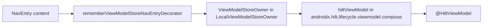

# Hilt 2.60.1 on this AGP 9 app

**Date:** 2026-10-24. **App:** single module `:app`, `com.dantech.skimbrowser`. AGP 9.4.1 built-in Kotlin (no `org.jetbrains.kotlin.android`), Kotlin 2.4.21, KSP 2.3.12, compileSdk/targetSdk 37, minSdk 26, Java 11 bytecode, lifecycle 2.11.0, Navigation 3 1.2.0, Room 2.8.5, R8 via `optimization { enable = true }` with no `packageScope`.

**Recommendation:** adopt stable **Dagger/Hilt 2.60.1** with the Gradle plugin `com.google.dagger.hilt.android`, the existing KSP plugin, and **`androidx.hilt:hilt-lifecycle-viewmodel-compose:1.4.0`**. Do not add `androidx.hilt:hilt-navigation-compose`. Pin **`org.jetbrains.kotlin:kotlin-metadata-jvm:2.4.21`** on every KSP configuration that runs `hilt-compiler`. There is no newer stable or RC on Maven Central, the Gradle Plugin Portal, or the GitHub releases list.

This session did not recompile `:app` with Hilt. A scratch spike recorded in [the 2026-10-20 build-stack report](researcher-261020-2319-android-build-stack-compose-m3e.md) reported `hiltJavaCompile` and `assembleDebug` succeeding with Hilt 2.60.1, KSP 2.3.12, Kotlin 2.4.20, and AGP 9.4.1. That spike is prior project research, not a result of this pass.

## Contents

1. [Version](#1-latest-stable-version)
2. [Gradle plugin vs KSP-only](#2-gradle-plugin-vs-ksp-only)
3. [KSP 2.3.12 and Kotlin 2.4.21](#3-ksp-2312-and-kotlin-2421)
4. [Dependencies and hiltViewModel](#4-dependencies-and-hiltviewmodel)
5. [Assisted injection](#5-hiltviewmodel-and-assistedinject)
6. [Tests and Robolectric 4.17](#6-tests-and-robolectric-417)
7. [R8](#7-r8)
8. [Configuration cache](#8-configuration-cache)
9. [Version catalog](#9-version-catalog)
10. [Sources](#10-sources)
11. [Trade-offs, risks, gaps](#11-trade-offs-risks-gaps)

## 1. Latest stable version

| Artifact | Coordinate | Maven `<release>` | `lastUpdated` |
|---|---|---|---|
| Runtime | `com.google.dagger:hilt-android` | **2.60.1** | 20260706203408 |
| Compiler | `com.google.dagger:hilt-compiler` | **2.60.1** | 20260706203410 |
| Gradle plugin jar | `com.google.dagger:hilt-android-gradle-plugin` | **2.60.1** | 20260706203409 |
| Plugin marker | `com.google.dagger.hilt.android:com.google.dagger.hilt.android.gradle.plugin` | **2.60.1** | 20260706203410 (Plugin Portal) |
| Core runtime used by Hilt | `com.google.dagger:dagger` | **2.60.1** | 20260706203357 |
| Test AAR | `com.google.dagger:hilt-android-testing` | **2.60.1** | published 2026-07-06 17:48 UTC (directory listing) |

GitHub release `dagger-2.60.1` is not a prerelease. Published 2026-07-06T21:28:59Z. The eight newest GitHub releases stop at 2.60.1; none is an RC. `dagger.dev` states "The latest Dagger release is: Dagger 2.60.1". No 2.61, 2.60.2, or RC appears in those metadata files.

**2.60.1 notes (bugfix on top of 2.60):**

- [#5203](https://github.com/google/dagger/issues/5203): Hilt compiler options such as `fastInit` again propagate to the aggregation compile tasks.
- [#5204](https://github.com/google/dagger/issues/5204): removed `@CanIgnoreReturnValue` from `ActivityRetainedComponentBuilder` after an import error.

**2.60 notes that matter for this app** (2026-06-26):

- KSP support is documented as stable from Dagger 2.60 and KSP 2.3.9. See [section 3](#3-ksp-2312-and-kotlin-2421).
- Hilt minSdk is 23. Multidex support is removed ([issue 380448311](https://issuetracker.google.com/380448311)). This app's minSdk 26 is inside that range.
- With the Gradle plugin, setting a plugin-controlled processor flag yourself is now an error. `enableAggregatingTask` stays default-on.
- Nullable type annotations are opt-in via `-Adagger.nullableTypeAnnotations=enabled`.
- Parameterless `@Binds` is new and optional.
- The release text says "Fixes #5190, #5180, #5177: Updated Kotlin version to 2.3.21". That PR ([#5179](https://github.com/google/dagger/pull/5179)) bumps Dagger's own Kotlin/KSP to 2.3.21 / 2.3.7. It does **not** bump `kotlin-metadata-jvm` to a 2.4 line. The published `hilt-compiler-2.60.1.pom` still depends on `org.jetbrains.kotlin:kotlin-metadata-jvm:2.3.21`. See [section 3](#3-ksp-2312-and-kotlin-2421).

**AGP floor, from earlier patch releases that 2.60.1 includes:**

- 2.59 (2026-01-21): Hilt Gradle plugin supports AGP 9. If you apply the plugin, AGP 9 is required, and so is AGP 9's Gradle requirement. Commit [6afd7ea](https://github.com/google/dagger/commit/6afd7ea5a0fb84a38f2d23c990ddbd95e728a39d) is the AGP 9 port and fixes [#4944](https://github.com/google/dagger/issues/4944) and [#4979](https://github.com/google/dagger/issues/4979).
- 2.59.1: minimum AGP when using the plugin is 9.0.0.
- 2.59.2: fixes a slow incremental build from `HiltSyncTask`, and a `jetifierEnabled=true` break. This project does not need Jetifier.

Android's [AGP 9 migration skill](https://developer.android.com/agents/skills/build-system/agp/agp-9-upgrade/skill) says Hilt must be 2.59.2 or newer. 2.60.1 satisfies that. The plugin's own tests were updated against AGP 9.0.0, not 9.4.1. There is no published maximum.

## 2. Gradle plugin vs KSP-only

**Plugin id:** `com.google.dagger.hilt.android`  
**Version:** `2.60.1`  
**Marker:** `com.google.dagger.hilt.android:com.google.dagger.hilt.android.gradle.plugin:2.60.1`, which depends on `com.google.dagger:hilt-android-gradle-plugin:2.60.1`.

Apply it on `:app` only. Declare it at the root with `apply false`, the same way this repo declares KSP.

The plugin is **not required to compile Hilt**. [Gradle setup](https://dagger.dev/hilt/gradle-setup) says the examples assume the plugin because it bytecode-transforms `@AndroidEntryPoint` and `@HiltAndroidApp`. Without the plugin, the annotation must name the base class and the class must extend the generated `Hilt_*` type:

```kotlin
@HiltAndroidApp(MultiDexApplication::class)
class MyApplication : Hilt_MyApplication()
```

With the plugin, the class extends the real base (`Application`, `ComponentActivity`) and the annotation has no value. The plugin also runs classpath aggregation (`enableAggregatingTask`, default on) so `@InstallIn` modules in `implementation` dependencies are visible. For a new adoption, use the plugin. KSP-only is the supported alternative when you are willing to extend `Hilt_*` by hand. It is not a fallback for a plugin that fails on this toolchain.

**The plugin does not require `org.jetbrains.kotlin.android`.**

- `HiltGradlePlugin.kt` at tag `dagger-2.60.1` registers processor options when `com.google.devtools.ksp` is applied, and separately when `kotlin-kapt` is applied (`plugins.withId`). It does not apply the Kotlin Android plugin. The published plugin jar's class files contain the UTF-8 string `com.google.devtools.ksp` and do not contain `org.jetbrains.kotlin.android`, `kotlin-android`, or `builtInKotlin`.
- The AGP 9 port ([6afd7ea](https://github.com/google/dagger/commit/6afd7ea5a0fb84a38f2d23c990ddbd95e728a39d), shipped in 2.59) says the plugin tests "Migrate to builtin kotlin" and "removed 'kotlin-android'". kapt tests moved to `com.android.legacy-kapt`. This app uses KSP, so it does not need `legacy-kapt` either.
- [#4944](https://github.com/google/dagger/issues/4944) is the pre-2.59 failure against AGP 9's new DSL. 2.59 closed that for the plugin. Do not stay on 2.58 or older.

**Do not set `android.disallowKotlinSourceSets=false`.** KSP [#2729](https://github.com/google/ksp/issues/2729) (KSP writing generated sources through `kotlin.sourceSets` under built-in Kotlin) was closed as fixed on KSP `main` and verified on `2.3.4-SNAPSHOT` (2025-12-12). This app is on KSP 2.3.12 and already runs Room's processor without that flag. The flag appears in Hilt's AGP 9 test fixtures ([e92e3f3](https://github.com/google/dagger/commit/e92e3f39220691b063f4a2ef3fbffb882326817e)) only as a workaround for that KSP bug. An April 2026 comment on #4944 still needed the flag with AGP 9.0.1 and Kotlin 2.3.20; that report does not name a KSP version at or after 2.3.4. This project's current KSP is past the fix.

What you still must add, plugin or not: `ksp("com.google.dagger:hilt-compiler:2.60.1")` (and the test configurations below). The plugin does not replace the compiler dependency.

## 3. KSP 2.3.12 and Kotlin 2.4.21

[Dagger's KSP page](https://dagger.dev/dev-guide/ksp) (live, versions shown as 2.60.1): "Dagger's KSP support is stable as of Dagger 2.60+ and KSP 2.3.9+." This app's KSP **2.3.12** is newer than 2.3.9. Maven Central lists `com.google.devtools.ksp:symbol-processing-gradle-plugin:2.3.12`. The POM's `Last-Modified` is Wed, 09 Sep 2026 17:36:34 GMT. The [GitHub release](https://github.com/google/ksp/releases/tag/2.3.12) was published 2026-09-09T18:27:29Z.

`hilt-compiler-2.60.1.pom` depends on `com.google.devtools.ksp:symbol-processing-api:2.3.7` and on `kotlin-stdlib:2.3.21`. A processor built against KSP 2.3.7 runs on the 2.3.12 plugin. KSP 2.3.12's new backing-field model is opt-in (`registerProcessorForNewFeatures`). Dagger 2.60.1 was published on 2026-07-06, before that KSP release, so it does not opt in and keeps the previous visitor behavior. That is fine for `@Inject` constructors and `@Module` types. It would miss an annotation that targeted only an explicit backing field. This app has no such Hilt use.

Two Kotlin 2.4 bugs are already addressed by this KSP, not by staying on an older Hilt:

- [KSP 2.3.10](https://github.com/google/ksp/releases/tag/2.3.10) (2026-07-09) sanitizes `:` in the Kotlin 2.4 default module name ([ksp#2964](https://github.com/google/ksp/issues/2964)). Dagger [#5180](https://github.com/google/dagger/issues/5180) was that KSP bug, not a missing Dagger release. 2.3.12 includes the fix. Kotlin's [KSP quickstart](https://kotlinlang.org/docs/ksp-quickstart.html) pairs Kotlin 2.4.21 with KSP 2.3.x (`2.3.10` in the example).
- The same 2.3.10 notes fix R-class resolution when AGP 9 built-in Kotlin is on ([ksp#2857](https://github.com/google/ksp/issues/2857)).

**kotlin-metadata-jvm is the remaining mismatch.**

`kotlin-metadata-jvm` 2.3.21 (the version in the Hilt 2.60.1 compiler POM) has `MetadataVersion.INSTANCE = MetadataVersion(2, 3, 0)` in Kotlin tag `v2.3.21`. Strict metadata newer than 2.3.0 is rejected. The error text "maximum supported version is 2.3.0" is emitted only when the metadata's strict-semantics flag is set (`JvmReadUtils.throwIfNotCompatible`). Kotlin 2.4.0 produced exactly that error against Hilt 2.59.2 ([#5177](https://github.com/google/dagger/issues/5177), [#5190](https://github.com/google/dagger/issues/5190), task `hiltJavaCompile…` in [#5180](https://github.com/google/dagger/issues/5180)). `kotlin-metadata-jvm` 2.4.21 has `INSTANCE = MetadataVersion(2, 4, 0)` (tag `v2.4.21`), so it can read this app's metadata.

The classes are not shaded. `hilt-compiler`, `dagger-compiler`, and `dagger-spi` 2.60.1 jars contain zero `kotlin/metadata` entries. Maintainer note on [#5059](https://github.com/google/dagger/issues/5059): metadata was unshaded so a project can upgrade it without waiting for Dagger. The confirmed workaround is a KSP dependency on the metadata jar that matches the language version (`ksp("org.jetbrains.kotlin:kotlin-metadata-jvm:2.4.0")` on #5177). Use **2.4.21**, which is on Maven Central and matches this app's Kotlin. Do not use `2.5.0-Beta2`, which is what that artifact's maven-metadata currently marks as `<latest>` / `<release>` (lastUpdated 20261021085505).

Put the metadata jar on each configuration that resolves `hilt-compiler`: `ksp`, `kspTest`, and `kspAndroidTest`. Those configurations do not all extend each other. The Hilt plugin source even comments that the variant-aware KSP configuration does not extend the main `ksp` configuration ([ksp#1433](https://github.com/google/ksp/issues/1433)).

**UNVERIFIED this session:** whether `:app:hiltJavaCompile` on Kotlin 2.4.21 still enters that reader. The 2026-10-20 scratch spike reported `hiltJavaCompile` success on Kotlin 2.4.20 and did not mention a metadata force. Adding 2.4.21 is still the right pin: if the reader runs, 2.3.21 cannot accept strict 2.4 metadata; if it does not, Gradle simply selects the higher unshaded version.

`androidx.hilt:hilt-compiler` is a different artifact (WorkManager's `@HiltWorker`). KSP support for it is documented as 1.4.x on the Dagger KSP page. This app does not use WorkManager. Do not add it for `@HiltViewModel`.

## 4. Dependencies and hiltViewModel

There is no Hilt Navigation 3 artifact. Google Maven group index for `androidx.hilt` lists only: `hilt-common`, `hilt-compiler`, `hilt-lifecycle-viewmodel`, `hilt-lifecycle-viewmodel-compose`, `hilt-navigation`, `hilt-navigation-compose`, `hilt-navigation-fragment`, `hilt-work`.

Navigation 3 scopes a `ViewModelStoreOwner` per `NavEntry` with `rememberViewModelStoreNavEntryDecorator()` from `androidx.lifecycle:lifecycle-viewmodel-navigation3`, which this app already depends on at 2.11.0. `hiltViewModel()` reads `LocalViewModelStoreOwner`. It does not take a `NavBackStackEntry`.



**Use:** `androidx.hilt:hilt-lifecycle-viewmodel-compose:1.4.0`  
Google Maven `<release>1.4.0</release>`, `lastUpdated` 20260701170021. [Release notes](https://developer.android.com/jetpack/androidx/releases/hilt): stable 1.4.0 on July 01, 2026; RC column empty. 1.4.0-rc01 was June 03, 2026, and is older than the stable. The POM depends on `androidx.lifecycle:lifecycle-viewmodel-compose:2.11.0` (matches this app) and on `com.google.dagger:hilt-android:2.59` (a floor; the app should declare 2.60.1, and Gradle's highest version wins). It does **not** depend on `androidx.navigation:navigation-compose`.

The training page [Hilt and Jetpack](https://developer.android.com/training/dependency-injection/hilt-jetpack) still shows `hilt-lifecycle-viewmodel-compose:1.3.0` and says both Navigation Compose and Navigation 3 call `hiltViewModel()` inside the destination, with `rememberViewModelStoreNavEntryDecorator()` for Nav3. The version on that page is stale. The package split is real: 1.3.0 (September 10, 2025) moved Compose `hiltViewModel()` into this artifact "such that they can be used without transitively depending on `androidx.navigation`."

**Signatures, from `hilt-lifecycle-viewmodel-compose-1.4.0-sources.jar`, `androidx/hilt/lifecycle/viewmodel/compose/HiltViewModel.kt`:**

```kotlin
@Composable
inline fun <reified VM : ViewModel> hiltViewModel(
    viewModelStoreOwner: ViewModelStoreOwner =
        checkNotNull(LocalViewModelStoreOwner.current) {
            "No ViewModelStoreOwner was provided via LocalViewModelStoreOwner"
        },
    key: String? = null,
): VM

@Composable
inline fun <reified VM : ViewModel, reified VMF> hiltViewModel(
    viewModelStoreOwner: ViewModelStoreOwner = /* same LocalViewModelStoreOwner default */,
    key: String? = null,
    noinline creationCallback: (VMF) -> VM,
): VM
```

Both parameters exist. `viewModelStoreOwner` defaults to the composition local, which the Nav3 decorator sets, so a destination calls `hiltViewModel()` or `hiltViewModel(key = …)` and does not pass a back-stack entry. `key` is how two entries of the same `ViewModel` class stay distinct; the [Nav3 assisted-argument recipe](https://developer.android.com/guide/navigation/navigation-3/recipes/passingarguments) calls this out. The assisted overload's `creationCallback` receives the `@AssistedFactory`.

`rememberHiltViewModelFactory(delegateFactory)` is the non-deprecated way to build a `ViewModelProvider.Factory` when a screen uses `viewModel(factory = …)` instead of `hiltViewModel()`. 1.4.0-beta01 removed the `ViewModelStoreOwner` parameter from that function. `createHiltViewModelFactory` in the same file is `@Deprecated("Replaced by rememberHiltViewModelFactory.")`.

**Do not use `androidx.hilt:hilt-navigation-compose:1.4.0` for this app.** Its POM depends on `androidx.navigation:navigation-compose:2.9.0` (Navigation 2) and on `lifecycle-viewmodel-compose:2.9.1`. Its `hiltViewModel` overloads, in package `androidx.hilt.navigation.compose`, are deprecated:

```kotlin
@Deprecated(
    "Moved to package: androidx.hilt.lifecycle.viewmodel.compose",
    replaceWith = ReplaceWith(
        expression = "hiltViewModel(viewModelStoreOwner, key)",
        imports = ["androidx.hilt.lifecycle.viewmodel.compose.hiltViewModel"],
    ),
)
```

The KDoc still talks about a `NavController` back stack. The implementation forwards to the lifecycle-compose function. Adding the artifact would pull Navigation 2 onto a Navigation 3 app for a deprecated wrapper.

`androidx.hilt:hilt-lifecycle-viewmodel:1.4.0` (the non-Compose factory) is already a transitive dependency of the Compose artifact. Declare the Compose artifact only.

| Need | Declare |
|---|---|
| `@HiltAndroidApp`, `@AndroidEntryPoint`, `@HiltViewModel` | `com.google.dagger:hilt-android:2.60.1` |
| Process those annotations | `ksp(com.google.dagger:hilt-compiler:2.60.1)` plus `kotlin-metadata-jvm:2.4.21` on that same configuration |
| `hiltViewModel()` in Compose / Nav3 | `androidx.hilt:hilt-lifecycle-viewmodel-compose:1.4.0` |
| Per-entry `ViewModelStoreOwner` | already on the app: `lifecycle-viewmodel-navigation3:2.11.0` |
| Unit / instrumented Hilt tests | `hilt-android-testing:2.60.1` on `testImplementation` and `androidTestImplementation`, plus `kspTest` / `kspAndroidTest` of `hilt-compiler` and the metadata jar |
| `@HiltWorker` | not used. Would also need `androidx.hilt:hilt-work` and `ksp(androidx.hilt:hilt-compiler:1.4.0)` |

## 5. @HiltViewModel and assisted injection

`@HiltViewModel` lives in `dagger.hilt.android.lifecycle` and is processed by `com.google.dagger:hilt-compiler`, not by `androidx.hilt:hilt-compiler`.

From [Hilt View Models](https://dagger.dev/hilt/view-model), current as of this fetch (examples assume the Gradle plugin):

- Ordinary constructor: `@Inject`. `SavedStateHandle` and `ViewModelLifecycle` are default `ViewModelComponent` bindings. `SavedStateHandle` is **not** an `@Assisted` parameter.
- Assisted constructor: `@AssistedInject`, assisted parameters marked `@Assisted`, and the factory named on the annotation: `@HiltViewModel(assistedFactory = MovieViewModelFactory::class)`. The factory is `@AssistedFactory` with one abstract create method.
- Do not inject the `ViewModel` or its assisted factory from Dagger directly. Retrieve the `ViewModel` through `ViewModelProvider` / `hiltViewModel()`.
- Assisted values are not saved across process death. Prefer `SavedStateHandle` when the value must survive that.

The Navigation 3 recipe imports the assisted types from Dagger, not from javax or jakarta:

```kotlin
import dagger.assisted.Assisted
import dagger.assisted.AssistedFactory
import dagger.assisted.AssistedInject
import dagger.hilt.android.lifecycle.HiltViewModel
```

Compose passes the factory with the second `hiltViewModel` overload (`creationCallback`), which calls `CreationExtras.withCreationCallback` (`dagger.hilt.android.lifecycle.withCreationCallback`).

**javax vs jakarta.** `dagger-2.60.1.pom` depends on both `jakarta.inject:jakarta.inject-api:2.0.1` and `javax.inject:javax.inject:1`. `@AssistedInject` / `@Assisted` / `@AssistedFactory` are `dagger.assisted` and are neither. Hilt 2.57.1 (2025-08-20) added support for the Jakarta `Singleton` annotation ([#4780](https://github.com/google/dagger/issues/4780)). This pass did not find a 2.60 doc that forbids `jakarta.inject.Inject` on a Hilt constructor. Both inject APIs are on Dagger's compile classpath. **UNVERIFIED:** a side-by-side compile of `jakarta.inject.Inject` versus `javax.inject.Inject` on `@HiltViewModel` with this exact toolchain. Use `javax.inject.Inject` or the Kotlin annotation the IDE inserts from `javax.inject` unless a file already imports Jakarta; do not mix the two on one constructor.

**Deprecations that are already gone, and one that is still in the 1.4.0 jars:**

- `@androidx.hilt.ViewModelInject` and `@androidx.hilt.Assisted` were removed in `androidx.hilt` 1.0.0-beta01. The replacement is `@HiltViewModel`.
- `hilt-navigation-compose`'s `hiltViewModel` is deprecated in 1.4.0, replaced by the lifecycle-compose package. See [section 4](#4-dependencies-and-hiltviewmodel).
- `createHiltViewModelFactory` in the lifecycle-compose artifact is deprecated in favor of `rememberHiltViewModelFactory`.
- `enableExperimentalClasspathAggregation` is deprecated on the Gradle plugin. Leave it unset. `enableAggregatingTask` is the replacement and is already the default.
- Dagger 2.60 removed multidex. Do not extend `MultiDexApplication` for Hilt's sake. The published `HiltTestApplication` extends `android.app.Application` (javap of the 2.60.1 AAR). Pages that still say it extends `MultiDexApplication` are behind 2.60.

2.60 also defers ViewModel metadata processing when the type is an error or the `@AssistedFactory` is missing ([#5160](https://github.com/google/dagger/issues/5160)), so a missing factory fails as a Hilt error instead of an earlier crash in the processor.

## 6. Tests and Robolectric 4.17

Packages verified from `hilt-android-testing-2.60.1-sources.jar` and the AAR's `classes.jar`:

| API | Where it lives |
|---|---|
| `@HiltAndroidTest` | `dagger.hilt.android.testing.HiltAndroidTest` |
| `HiltAndroidRule` | `dagger.hilt.android.testing.HiltAndroidRule` |
| `HiltTestApplication` | `dagger.hilt.android.testing.HiltTestApplication` |
| `@UninstallModules` | `dagger.hilt.android.testing.UninstallModules` |
| `@BindValue`, `@BindValueIntoSet`, `@BindValueIntoMap`, `@BindElementsIntoSet` | `dagger.hilt.android.testing` |
| `@CustomTestApplication` | `dagger.hilt.android.testing.CustomTestApplication` |
| `@TestInstallIn` | `dagger.hilt.testing.TestInstallIn` |
| `@HiltAndroidApp` | production application only (`dagger.hilt.android.HiltAndroidApp`). Not a test annotation. |

There is **no `HiltTestRunner` class** in the 2.60.1 testing AAR. [Android's Hilt testing guide](https://developer.android.com/training/dependency-injection/hilt-testing) and [Dagger's Robolectric page](https://dagger.dev/hilt/robolectric-testing) both say: keep a JUnit 4 test, add `@HiltAndroidTest` and `HiltAndroidRule`, and point the test process at `HiltTestApplication`.

`javap` of the 2.60.1 class:

```text
public final class dagger.hilt.android.testing.HiltTestApplication
    extends android.app.Application
    implements GeneratedComponentManager, TestApplicationComponentManagerHolder {
  public dagger.hilt.android.testing.HiltTestApplication();
}
```

The constructor is public. That matters for Robolectric. Commit [22ca583](https://github.com/google/dagger/commit/22ca583ec71cdab98cef5c8cc0b76de68e709e00) (2026-07-06, the same day as 2.60.1) says a Robolectric change instantiates the application through `AppComponentFactory` and fails when the test `Application` is not public. The stock class in this AAR is public. **UNVERIFIED:** whether every `@CustomTestApplication`-generated class in this same release is public. The GitHub commit summary only shows a one-line test edit. Prefer `HiltTestApplication` unless a test truly needs the production `Application` subclass.

**Robolectric 4.17**, from the [compatibility table](https://robolectric.org/compatibility_table/): Android API 23 through 37. Built with Gradle 9.6.1 and AGP 9.2.1. The same table says running tests against Android API 37 requires Java 21. This project's unit-test daemon is JDK 25 (`app/build.gradle.kts` comment) and already opens the JDK modules Robolectric needs. Java 11 is the bytecode target, not the test JVM. No extra Hilt-specific Robolectric flag was found in the 4.17 compatibility table.

This app's unit tests use `@RunWith(AndroidJUnit4::class)` and, where needed, `@Config`. A Hilt unit test keeps that runner and adds:

```kotlin
@HiltAndroidTest
@Config(application = HiltTestApplication::class)
@RunWith(AndroidJUnit4::class)
class ExampleTest {
    @get:Rule(order = 0)
    val hiltRule = HiltAndroidRule(this)
}
```

`HiltAndroidRule` must run before rules that start an activity (`order = 0`). Call `hiltRule.inject()` before reading `@Inject` fields. `@BindValue` fields that an activity reads must be initialized on the property, not in `@Before`, because `ActivityScenarioRule` creates the activity first.

`@TestInstallIn` replaces a production `@InstallIn` module for the whole test source set and is what Dagger recommends. `@UninstallModules`, `@BindValue`, and a nested `@InstallIn` module generate a component per test class and cost more compile time. `@UninstallModules` cannot uninstall a `@TestInstallIn` module.

**Instrumented tests.** The app's `testInstrumentationRunner` is `androidx.test.runner.AndroidJUnitRunner`. Hilt does not ship a replacement runner. The documented pattern is a subclass that overrides `newApplication` and passes `HiltTestApplication::class.java.name`. Setting that as `testInstrumentationRunner` applies to **every** instrumented test, including tests that do not use Hilt and that depend on the real `Application.onCreate`. Do that only when an instrumented test actually needs Hilt. Robolectric tests can select the application per class with `@Config` and can leave the instrumentation runner alone.

`kspTest` and `kspAndroidTest` must both see `hilt-compiler`. Without that, `@HiltAndroidTest` compiles and then fails at runtime looking for a generated `*_TestComponentDataSupplier`. [KSP #3050](https://github.com/google/ksp/issues/3050) reports that KSP 2.3.10 skips `ksp*AndroidTest` on an **Android library** module (AGP 9.3.0, Hilt 2.60.1) even when sources exist. This repo is one `com.android.application` module, which is outside that report's scope. **UNVERIFIED** for `:app`. The first instrumented Hilt test should confirm the `ksp*AndroidTest` task ran.

## 7. R8

Release uses `optimization { enable = true }` and does not set `packageScope`. On AGP 9.3+ that block turns on R8 shrinking, resource shrinking, and the optimized defaults ([Enable app optimization](https://developer.android.com/topic/performance/app-optimization/enable-app-optimization)). R8 full mode has been the default since AGP 8.0 unless `android.enableR8.fullMode=false`. This repo's `gradle.properties` does not set that opt-out. [packageScope](https://developer.android.com/topic/performance/app-optimization/optimize-specified-packages) is an experimental way to optimize only some packages while adopting R8. The same page says an app that already runs R8 should not set `packageScope`. Leaving it unset means full mode optimizes every package, including Hilt's generated classes and `com.google.dagger`. That is the right setting. `packageScope` does not change which consumer keep rules are loaded; it changes which packages are optimized.

`hilt-android-2.60.1.aar` is class-file major version 52 (Java 8). That is inside this app's Java 11 target. R8 consumes the AAR's `proguard.txt`. The file's bytes are:

```
-keep,allowobfuscation,allowshrinking @dagger.hilt.EntryPoint class *
-keep,allowobfuscation,allowshrinking @dagger.hilt.internal.ComponentEntryPoint class *
-keep,allowobfuscation,allowshrinking @dagger.hilt.internal.GeneratedEntryPoint class *
-keep,allowobfuscation,allowshrinking @dagger.hilt.android.EarlyEntryPoint class *
```

The first rule is missing a newline before the following comment. `#` starts a ProGuard comment, so the rule still ends at `class *`. There is no `**.Hilt_*` rule in that file.

`dagger-2.60.1.jar` ships:

```
# META-INF/com.android.tools/r8/r8.pro
-identifiernamestring @dagger.internal.IdentifierNameString class ** {
    static java.lang.String *;
}

# META-INF/com.android.tools/proguard/proguard.pro
-keepclassmembers,includedescriptorclasses class * {
   @dagger.internal.KeepFieldType <fields>;
}
```

Those are the default consumer rules. They are not package-scoped. AGP 9 filters **global** options (`-dontobfuscate` and similar) out of library consumer rules. These Hilt/Dagger rules are `-keep` / `-identifiernamestring`, not global options, so that filter does not drop them.

**Open, not fixed in 2.60.1:** [PR #5195](https://github.com/google/dagger/pull/5195) (still open as of its last comment on 2026-06-23) proposes `-keep,allowobfuscation,allowshrinking class **.Hilt_*` for a full-mode `ClassCastException` when R8 vertically merges an `@AndroidEntryPoint` class that has no members of its own into its `Hilt_*` base ([#4668](https://github.com/google/dagger/issues/4668)). Maintainer bcorso did not merge it and asked for a minimal R8 repro, suspecting an R8 bug. Another reviewer said their full-mode app does not hit it. Do not add that keep preemptively. Do run one release (`optimization.enable`) build that actually constructs each `@AndroidEntryPoint` type, especially a type whose body is only `onCreate` calling `super`, or a `Service` / `BroadcastReceiver` with no extra members. If that crashes with `ClassCastException` inside `EntryPoints.get`, the open PR's rule is the short-term mitigation, and it should be an app `keepRules` file, not a guess added before the crash exists.

No `packageScope`-specific Hilt failure was found. The risk of omitting `packageScope` is the opposite of a Hilt break: full mode optimizes Hilt, which is what the consumer rules above are written for.

## 8. Configuration cache

`gradle.properties` sets `org.gradle.configuration-cache=true`. The repo README says KSP does not serialize into the configuration cache, and the documented Gradle commands pass `--no-configuration-cache`. That flag overrides the property. Keep passing it.

What was checked:

- `symbol-processing-gradle-plugin-2.3.12.jar` (166,498 bytes) contains none of `notCompatibleWithConfigurationCache`, `ConfigurationCache`, `configuration cache`, or `compatibleWithConfigurationCache`.
- `hilt-android-gradle-plugin-2.60.1.jar` class files also lack `notCompatibleWithConfigurationCache`.
- [ksp#2059](https://github.com/google/ksp/issues/2059) (`KspTaskJvm` cannot be stored in the configuration cache) was closed on 2026-01-14 because the KSP1 task type was removed. That does not prove the KSP2 task (`KspAA`) stores cleanly.
- [ksp#1604](https://github.com/google/ksp/issues/1604) describes configuration-cache invalidation when KSP creates a resources directory during configuration. The issue was not updated for 2.3.12.

**UNVERIFIED:** a 2.3.12 maintainer statement that the KSP2 task is configuration-cache compatible, and a fresh store/reuse cycle of this app after Hilt is applied. The 2026-10-20 scratch spike reported that a configuration-cache entry stored with Hilt 2.60.1 and that the problems report only had a Kotlin deprecation warning. This session did not re-run that. Hilt 2.60.1 does not add a new documented requirement to disable the cache, and nothing in this pass shows that it removes the KSP reason the README already disables it. Leave the flag in place until a two-run check (`store`, then `Reusing configuration cache`) succeeds on `:app:assembleDebug` and `:app:testDebugUnitTest` with the Hilt plugin applied.

## 9. Version catalog

Versions below were read from maven-metadata or from the published POM/AAR on 2026-10-24. Comments follow this repo's `GM` / `MC` / `GPP` style.

```toml
[versions]
hilt = "2.60.1"                # MC com/google/dagger/hilt-android (release 2.60.1, lastUpdated 20260706); same version for hilt-compiler, hilt-android-testing, and the Gradle plugin
hiltLifecycleViewmodelCompose = "1.4.0" # GM androidx/hilt/hilt-lifecycle-viewmodel-compose (release 1.4.0, lastUpdated 20260701)
kotlinMetadata = "2.4.21"      # MC org/jetbrains/kotlin/kotlin-metadata-jvm; matches Kotlin 2.4.21. Not 2.5.0-Beta2.

[libraries]
hilt-android = { group = "com.google.dagger", name = "hilt-android", version.ref = "hilt" }
hilt-compiler = { group = "com.google.dagger", name = "hilt-compiler", version.ref = "hilt" }
hilt-android-testing = { group = "com.google.dagger", name = "hilt-android-testing", version.ref = "hilt" }
androidx-hilt-lifecycle-viewmodel-compose = { group = "androidx.hilt", name = "hilt-lifecycle-viewmodel-compose", version.ref = "hiltLifecycleViewmodelCompose" }
kotlin-metadata-jvm = { group = "org.jetbrains.kotlin", name = "kotlin-metadata-jvm", version.ref = "kotlinMetadata" }

[plugins]
hilt = { id = "com.google.dagger.hilt.android", version.ref = "hilt" }
```

Root `plugins` block: `alias(libs.plugins.hilt) apply false`.  
`:app` plugins block: `alias(libs.plugins.hilt)` next to the existing KSP plugin. Do not add `org.jetbrains.kotlin.android`.

```kotlin
dependencies {
    implementation(libs.hilt.android)
    implementation(libs.androidx.hilt.lifecycle.viewmodel.compose)
    ksp(libs.hilt.compiler)
    ksp(libs.kotlin.metadata.jvm)

    testImplementation(libs.hilt.android.testing)
    kspTest(libs.hilt.compiler)
    kspTest(libs.kotlin.metadata.jvm)

    androidTestImplementation(libs.hilt.android.testing)
    kspAndroidTest(libs.hilt.compiler)
    kspAndroidTest(libs.kotlin.metadata.jvm)
}
```

Do not add `androidx.hilt:hilt-navigation-compose`, `androidx.hilt:hilt-compiler`, or `com.google.dagger:dagger` / `dagger-compiler` unless a type needs Dagger without Hilt. `hilt-compiler` already brings `dagger-compiler`.

## 10. Sources

Checked 2026-10-24.

**Maven and artifacts**

- https://repo1.maven.org/maven2/com/google/dagger/hilt-android/maven-metadata.xml
- https://repo1.maven.org/maven2/com/google/dagger/hilt-compiler/maven-metadata.xml
- https://repo1.maven.org/maven2/com/google/dagger/hilt-compiler/2.60.1/hilt-compiler-2.60.1.pom
- https://repo1.maven.org/maven2/com/google/dagger/dagger/maven-metadata.xml
- https://repo1.maven.org/maven2/com/google/dagger/dagger/2.60.1/dagger-2.60.1.pom
- https://repo1.maven.org/maven2/com/google/dagger/hilt-android-gradle-plugin/maven-metadata.xml
- https://repo1.maven.org/maven2/com/google/dagger/hilt/android/com.google.dagger.hilt.android.gradle.plugin/2.60.1/com.google.dagger.hilt.android.gradle.plugin-2.60.1.pom
- https://plugins.gradle.org/m2/com/google/dagger/hilt/android/com.google.dagger.hilt.android.gradle.plugin/maven-metadata.xml
- https://repo1.maven.org/maven2/com/google/dagger/hilt-android-testing/2.60.1/ (AAR, not a jar)
- https://dl.google.com/dl/android/maven2/androidx/hilt/group-index.xml
- https://dl.google.com/dl/android/maven2/androidx/hilt/hilt-lifecycle-viewmodel-compose/maven-metadata.xml
- https://dl.google.com/dl/android/maven2/androidx/hilt/hilt-lifecycle-viewmodel-compose/1.4.0/hilt-lifecycle-viewmodel-compose-1.4.0.pom
- https://dl.google.com/dl/android/maven2/androidx/hilt/hilt-lifecycle-viewmodel-compose/1.4.0/hilt-lifecycle-viewmodel-compose-1.4.0-sources.jar
- https://dl.google.com/dl/android/maven2/androidx/hilt/hilt-navigation-compose/1.4.0/hilt-navigation-compose-1.4.0.pom
- https://dl.google.com/dl/android/maven2/androidx/hilt/hilt-navigation-compose/1.4.0/hilt-navigation-compose-1.4.0-sources.jar
- https://repo1.maven.org/maven2/org/jetbrains/kotlin/kotlin-metadata-jvm/maven-metadata.xml
- https://repo1.maven.org/maven2/com/google/devtools/ksp/symbol-processing-gradle-plugin/maven-metadata.xml

**Dagger / Hilt docs and releases**

- https://dagger.dev/ (latest release line: 2.60.1)
- https://dagger.dev/hilt/gradle-setup
- https://dagger.dev/dev-guide/ksp
- https://dagger.dev/hilt/view-model
- https://dagger.dev/hilt/testing
- https://dagger.dev/hilt/robolectric-testing
- https://github.com/google/dagger/releases/tag/dagger-2.60.1
- https://github.com/google/dagger/releases/tag/dagger-2.60
- https://github.com/google/dagger/releases/tag/dagger-2.59
- https://github.com/google/dagger/releases/tag/dagger-2.59.1
- https://github.com/google/dagger/releases/tag/dagger-2.57.1
- https://github.com/google/dagger/commit/6afd7ea5a0fb84a38f2d23c990ddbd95e728a39d
- https://github.com/google/dagger/blob/dagger-2.60.1/java/dagger/hilt/android/plugin/main/src/main/kotlin/dagger/hilt/android/plugin/HiltGradlePlugin.kt
- https://github.com/google/dagger/issues/4944
- https://github.com/google/dagger/issues/5059
- https://github.com/google/dagger/issues/5177
- https://github.com/google/dagger/issues/5180
- https://github.com/google/dagger/issues/5190
- https://github.com/google/dagger/pull/5179
- https://github.com/google/dagger/pull/5195
- https://github.com/google/dagger/commit/22ca583ec71cdab98cef5c8cc0b76de68e709e00

**AndroidX, AGP, Navigation 3, KSP, Robolectric, R8**

- https://developer.android.com/jetpack/androidx/releases/hilt
- https://developer.android.com/training/dependency-injection/hilt-jetpack
- https://developer.android.com/training/dependency-injection/hilt-testing
- https://developer.android.com/reference/kotlin/androidx/hilt/lifecycle/viewmodel/compose/hiltViewModel.composable (page says last updated 2026-06-24; the 1.4.0 sources jar is the signature used above)
- https://developer.android.com/guide/navigation/navigation-3/recipes/passingarguments
- https://developer.android.com/build/migrate-to-built-in-kotlin
- https://developer.android.com/agents/skills/build-system/agp/agp-9-upgrade/skill
- https://developer.android.com/topic/performance/app-optimization/enable-app-optimization
- https://developer.android.com/topic/performance/app-optimization/optimize-specified-packages
- https://github.com/google/ksp/releases/tag/2.3.12
- https://github.com/google/ksp/releases/tag/2.3.10
- https://github.com/google/ksp/issues/2729
- https://github.com/google/ksp/issues/3050
- https://kotlinlang.org/docs/ksp-quickstart.html
- https://raw.githubusercontent.com/JetBrains/kotlin/v2.3.21/core/metadata/src/org/jetbrains/kotlin/metadata/deserialization/MetadataVersion.kt
- https://raw.githubusercontent.com/JetBrains/kotlin/v2.4.21/core/metadata/src/org/jetbrains/kotlin/metadata/deserialization/MetadataVersion.kt
- https://robolectric.org/compatibility_table/

## 11. Trade-offs, risks, gaps

| Choice | Fit for this app | What you give up | Adoption risk |
|---|---|---|---|
| **Hilt 2.60.1 + plugin + KSP + `hilt-lifecycle-viewmodel-compose` 1.4.0** | Matches AGP 9 built-in Kotlin, existing KSP, lifecycle 2.11, Nav3. One module, so aggregation cost is small. | Another KSP processor and a `hiltJavaCompile` task. Test fakes move to `@TestInstallIn` / `@BindValue`. | Low for the plugin itself (AGP 9 support since 2.59). Medium for the metadata pin and for the first release build of thin `@AndroidEntryPoint` types. No newer RC to wait for. |
| KSP-only, no Gradle plugin | Compiles, and avoids one plugin. | Every `@AndroidEntryPoint` / `@HiltAndroidApp` must extend a generated `Hilt_*` class. Docs and samples do not match the code. Aggregation of `implementation` dependencies is weaker. | Higher long-term mistake rate. Use only if the plugin fails a real build. It is not the AGP 9 workaround. |
| `hilt-navigation-compose` 1.4.0 | None. The functions are deprecated wrappers. | Pulls Navigation 2 (`navigation-compose` 2.9.0) into a Navigation 3 app. | Do not adopt. |
| Wait for a Hilt newer than 2.60.1 | Nothing to wait for on 2026-10-24. | Delays DI. | None. Re-check Maven metadata when adopting if this report is more than a few weeks old. |

**Rank:** the first row.

**Limitations of this pass**

- No Gradle build of `:app` with these dependencies was run. The 2026-10-20 spike is the only compile evidence, it used Kotlin 2.4.20 rather than 2.4.21, and its build scripts were not re-opened here.
- Whether `hiltJavaCompile` on this app still needs the metadata pin is inferred from the POM and from pre-2.60 bug reports, not from a failing log of 2.60.1.
- Configuration-cache behavior of the full KSP task classpath (not just the 166 KB plugin jar) was not re-run.
- `@CustomTestApplication` constructor visibility, `jakarta.inject.Inject` on `@HiltViewModel`, and KSP androidTest on this application module were not executed.
- The R8 vertical-merge crash was not reproduced. The proposed keep rule is unmerged.

**Unresolved before implementation**

1. After the dependencies land, does `:app:hiltJavaCompileDebug` fail with "maximum supported version is 2.3.0" if `kotlin-metadata-jvm:2.4.21` is omitted? If it fails, the pin above is the fix. If it does not, leave the pin anyway so a later classpath change cannot silently resolve 2.3.21.
2. Does the second `--configuration-cache` run of `assembleDebug` and `testDebugUnitTest` reuse the entry once the Hilt plugin is applied?
3. Does a minified `release` / `releaseSmoke` build construct every `@AndroidEntryPoint` type without `ClassCastException`?
4. Will any instrumented test need Hilt? If yes, the custom `AndroidJUnitRunner` replaces the runner for the whole `androidTest` source set, and the production `Application` will not run.
