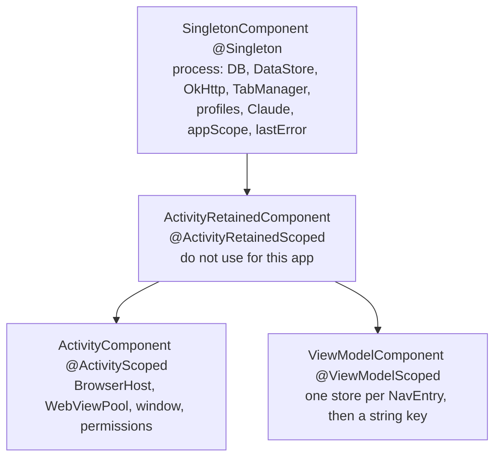

# Hilt migration for Skim's composition root

**Date:** 2026-10-24
**Question:** How to replace `AppContainer` with Hilt and still keep `DomainBoundaryTest` green, Navigation 3 keys working, and unit tests constructing ViewModels by hand.
**Stack checked:** Dagger/Hilt 2.60.1 (2026-07-06), `androidx.hilt` 1.4.0 (2026-07-01), Navigation 3 1.2.0, `lifecycle-viewmodel-navigation3` 2.11.0, AGP 9.4.1, Gradle 9.6.0, Kotlin 2.4.21, KSP 2.3.12, minSdk 26. This repo already sets `org.gradle.configuration-cache=true`.

## Outcome

Use Hilt 2.60.1 with the Hilt Gradle plugin and the existing KSP plugin. Official Android docs still call Hilt the recommended Android DI library as of 2026-10-16. Nothing in those docs replaces it.

Put process objects on `SingletonComponent` (`@Singleton`): OkHttp, Room, DataStore, `TabManager`, WebView profiles, the Claude client, `appScope`, and `lastError`. Put `BrowserHost` and `WebViewPool` on `ActivityComponent` (`@ActivityScoped`). Do not invent a custom component. Do not mark the pool or the navigator `@Singleton` or `@ActivityRetainedScoped`. `MainActivity` handles rotation with `configChanges` and is not recreated; retained scope buys nothing here and would keep a dead `Activity` if a real recreate ever happens.

`@Binds` for repository interfaces lives in `data/`, `browser/`, and `ai/`, never in `domain/`. Domain use cases stay free of `javax.inject` and `dagger` by being constructed in a `@Provides` module outside `domain/`. That keeps `DomainBoundaryTest` green without a special case, including the rule that only code under `data/` may name the concrete chat repository.

Navigation 3 does not use `androidx.hilt:hilt-navigation-compose`. Use `androidx.hilt:hilt-lifecycle-viewmodel-compose:1.4.0` and `androidx.hilt.lifecycle.viewmodel.compose.hiltViewModel`. Pass the existing string key. Pass nav args with `@Assisted` and `creationCallback`. `SavedStateHandle` does not receive the Navigation 3 key.

Unit tests keep calling `ViewModel(...)`. Official Hilt testing docs say constructor injection does not require Hilt in a unit test.

`@BindValue` cannot replace `AppStorage.temp(dir)` on a Robolectric class that is not `@HiltAndroidTest`. `@TestInstallIn` is the right override, and it still only applies to Hilt tests. There is no documented way to vary a Hilt binding without `@HiltAndroidTest` on the class that boots the graph.

One graph at a time. The change that deletes `AppContainer(app, storage)` also switches the tests that called it. A later "tests" phase cannot be the first time those tests change, or the suite does not compile, or both roots open Room.

## Component map



Hilt's own lifetimes, from [the component page](https://dagger.dev/hilt/components):

| Component | Scope | Created | Destroyed |
| --- | --- | --- | --- |
| `SingletonComponent` | `@Singleton` | `Application.onCreate()` | Process death |
| `ActivityRetainedComponent` | `@ActivityRetainedScoped` | First `Activity.onCreate()` | Last `Activity.onDestroy()` (survives configuration change) |
| `ActivityComponent` | `@ActivityScoped` | `Activity.onCreate()` | `Activity.onDestroy()` |
| `ViewModelComponent` | `@ViewModelScoped` | ViewModel created | ViewModel cleared |

`ActivityComponent` can see `SingletonComponent` bindings. The reverse is a compile error. Default bindings on `ActivityComponent` are `Activity` and `FragmentActivity`, not `ComponentActivity` ([component default bindings](https://dagger.dev/hilt/components)). `MainActivity` extends `ComponentActivity`. Widen the type in an `@InstallIn(ActivityComponent::class)` module with `activity as ComponentActivity`. Do not `@Inject MainActivity`; Hilt binds the base activity type, not the subclass ([Android Hilt components](https://developer.android.com/training/dependency-injection/hilt-android)).

### What is `@Singleton`

Everything `AppContainer` owns today: `SkimDatabase`, DataStore, `OkHttpClient`, `TabManager`, `WebViewProfiles`, `IncognitoSession`, `ClaudeClientProvider`, repositories, use cases, `appScope`, and `lastError`. Room's own rule is one `RoomDatabase` per process ([Room](https://developer.android.com/training/data-storage/room)). The deprecated Hilt codelab shows the same shape: `@Provides @Singleton` for the database in a module installed in `SingletonComponent` ([Hilt codelab](https://developer.android.com/codelabs/android-hilt)).

`@Singleton` on a `@Provides` method is what makes the body run once. Without it, Hilt runs the body on every injection ([`@Provides`](https://developer.android.com/training/dependency-injection/hilt-android)), which is a second database.

### What is `@ActivityScoped`

`BrowserHost` and everything it holds: `WebViewPool`, `SitePermissionBridge`, `DownloadRouter`, `BlobBridge`, `ActivityHost`, `FullscreenController`, `WindowSecureController`. They are built in `createBrowserHost` during `onCreate` and `BrowserHost.destroy()` runs in `onDestroy`. That is `ActivityComponent`, not the process.

`WebView.destroy()` must run on the thread that created the WebView, after the view is removed, and nothing may use that WebView afterwards ([WebView.destroy](https://developer.android.com/reference/android/webkit/WebView#destroy())). Hilt dropping an `ActivityComponent` reference does not call `destroy()`. `MainActivity` still calls `host.destroy()` from `onDestroy`.

`@ActivityScoped` types that capture `Activity` are created when first injected. Inject `BrowserHost` into the `@AndroidEntryPoint` activity so the pool exists before `setContent`, which matches today's order.

### Why not `@ActivityRetainedScoped`

Retained scope exists to survive a configuration change that destroys and recreates the activity ([component lifetimes](https://dagger.dev/hilt/components)). This activity lists `orientation|screenSize|screenLayout|smallestScreenSize|uiMode|keyboard|keyboardHidden|navigation|density|fontScale|layoutDirection|locale|fontWeightAdjustment` in `AndroidManifest.xml` and the `MainActivity` comment says those changes do not recreate it. A retained pool is not required for rotation.

The pool's constructor takes the `ComponentActivity`. The navigator's `WindowPrivacy` is `WindowSecureController(activity)`. Hilt's assisted-injection rule is the same constraint in writing: do not pass an `Activity`, `Fragment`, or `View` into an object that outlives it ([ViewModel assisted injection](https://dagger.dev/hilt/view-model.html)). A retained object would keep that activity across a real recreate (a config change that is not in the manifest, or a test that destroys the activity without finishing the task). `onDestroy` of the old activity would either destroy a pool the new activity still holds, or skip `destroy()` and leave WebViews on the dead window.

### Why not a custom component

Custom components must be children of `SingletonComponent` and cannot be inserted between the standard components ([custom components](https://dagger.dev/hilt/custom-components.html)). The caller owns their lifetime. `ActivityComponent` already matches `onCreate`/`onDestroy`. A custom "browser session" component would be a second lifecycle to keep in sync with `BrowserHost.destroy()`.

### `SkimNavigator` is not an `@ActivityScoped` constructor

`SkimApp` builds the navigator inside `remember(backStack, scope)` only after startup settings have loaded. The arguments that Hilt cannot know at `Activity.onCreate` are the `NavBackStack` from `rememberNavBackStack`, the `rememberCoroutineScope()`, and `host.secure`.

Inject an `@AssistedFactory` from `ActivityComponent`. The composable keeps the one `remember` call and passes those three runtime values. Process dependencies (`TabsController`, incognito, snackbar, AI gate) are constructor-injected into the navigator by the factory. That is one graph. A second `SkimNavigator(...)` site in `MainActivity` would be a second root.

Do not `@Singleton` the navigator. The first instance would keep the first window's `FLAG_SECURE` controller for the rest of the process.

`@ActivityRetainedScoped` has the same stale-window problem on any recreate, and it still cannot see the back stack until composition.

### What breaks if the pool is `@Singleton`

`SingletonComponent` dies with the process, not with the activity ([component lifetimes](https://dagger.dev/hilt/components)). After `onDestroy`:

- The pool still holds the destroyed `Activity` and its window. The activity cannot be collected.
- `WebView.destroy()` has not run, so the WebView's internal state is still alive ([WebView.destroy](https://developer.android.com/reference/android/webkit/WebView#destroy())).
- A later activity in the same process receives the pool whose WebViews were created on the old activity's thread and context. The next `destroy()` call is on the wrong lifetime, and a second `WebViewPool` is not created because of `@Singleton`.
- Instrumentation tests share one application instance across test cases when a custom application is used ([Hilt testing, custom application](https://dagger.dev/hilt/testing)). A process-scoped pool makes that leak cross tests, not just configuration changes.

`@ActivityScoped` plus an explicit `destroy()` is the same contract `BrowserHost` documents today.

## Test storage: `@TestInstallIn` over `@BindValue`

`AppContainer(app, AppStorage.temp(dir))` exists so a test can open Room, DataStore, tab state, and thumbnails in one directory, `close()`, and open another container on the same files (`AppContainerStorageTest`).

Hilt's test setup is three steps, for Robolectric and instrumentation alike: `@HiltAndroidTest`, `HiltAndroidRule`, and `HiltTestApplication` ([testing](https://dagger.dev/hilt/testing), [Robolectric](https://dagger.dev/hilt/robolectric-testing), [instrumentation](https://dagger.dev/hilt/instrumentation-testing)). "Each test gets its own set of Hilt components." The instrumentation lifecycle diagram shows one `Application` for the process and a new `SingletonComponent` per test case ([early entry points](https://dagger.dev/hilt/early-entry-point)). `@Singleton` is therefore per test case, not per process, only inside that Hilt test setup.

### `@BindValue` loses

`@BindValue` binds a field on a `@HiltAndroidTest` class. Replacing an existing binding also needs `@UninstallModules` on that class ([Android Hilt testing](https://developer.android.com/training/dependency-injection/hilt-testing), [Dagger testing](https://dagger.dev/hilt/testing)). It does not accept a scope annotation. The field is read on every request, so a single field initializer acts as the singleton only if the test never replaces the field. Each such class gets its own generated component, which the docs warn is slower; they say to prefer `@TestInstallIn`.

The field initializer must run before the activity is created. `ActivityScenarioRule` runs before `@Before`. Dagger's warning: a `@BindValue` set in `@Before` can be read uninitialized ([testing](https://dagger.dev/hilt/testing)).

`@BindValue` does nothing on a class that is not `@HiltAndroidTest`. The annotation is processed as part of that test's component.

### `@TestInstallIn` is the one to use

A module annotated `@TestInstallIn(components = [SingletonComponent::class], replaces = [StorageModule::class])` replaces the production storage module for every Hilt test in that source set ([testing](https://dagger.dev/hilt/testing)). One module, not one nested module per class.

It still does not remove `@HiltAndroidTest`. The Android guide's "all the tests in that folder" sentence is about tests that Hilt injects. The setup section says `@HiltAndroidTest` is what generates the test components. A plain Robolectric class never installs that module. **UNVERIFIED** as a single sentence on dagger.dev; it is the combination of the setup rules and the `@TestInstallIn` section. No page describes a binding override that works without `@HiltAndroidTest`.

The replacement provider should be `@Singleton` and should read a holder:

```kotlin
object TestStorage {
    val current: AtomicReference<AppStorage> = AtomicReference()
}

@Module
@TestInstallIn(
    components = [SingletonComponent::class],
    replaces = [StorageModule::class],
)
object TestStorageModule {
    @Provides
    @Singleton
    fun storage(): AppStorage =
        TestStorage.current.get() ?: error("TestStorage was not set")
}
```

Set `TestStorage.current` from the test instance field initializer, before any rule injects. Clear it when the test case ends. `@Provides` runs when the type is first requested, not when the component object is created ([Hilt codelab](https://developer.android.com/codelabs/android-hilt)), so a value set before `hiltRule.inject()` or before the activity is the value the singleton caches. **UNVERIFIED:** that `HiltAndroidRule` itself never requests `AppStorage` during rule setup. Do not inject `AppStorage` into a type the rule creates.

`@BindValue` cannot carry `@Singleton`. Two injection sites in one test would still share one object only because they re-read the same field. `@TestInstallIn` plus `@Singleton` matches production, where the database name and the directories must be one `AppStorage`.

### Robolectric without annotating every class

Unit tests that call `ViewModel(...)` do not boot Hilt and do not need either annotation. Official text: Hilt is not necessary for unit tests; call the constructor with fakes ([Android Hilt testing, Unit tests](https://developer.android.com/training/dependency-injection/hilt-testing)).

Any class that starts the Hilt application and needs a temp directory needs `@HiltAndroidTest`, `HiltAndroidRule`, and a Hilt test application. `@TestInstallIn` avoids repeating the module. It does not avoid the three setup steps. `@BindValue` repeats them and adds `@UninstallModules`.

Do not put `application = dagger.hilt.android.testing.HiltTestApplication` in `robolectric.properties` until every Robolectric test that loads an `Application` can live with it. That file is source-set-wide ([Robolectric testing](https://dagger.dev/hilt/robolectric-testing)). A test that is not `@HiltAndroidTest` then gets an application with no test component and without `SkimApplication.onCreate`. Prefer `@Config(application = HiltTestApplication::class)` on the Hilt tests only, until the non-Hilt Robolectric tests are gone.

**UNVERIFIED:** Robolectric 4.17's default sandbox does not document, in the Hilt pages, whether it builds a new `Application` per test method. Do not use a fresh sandbox as the isolation mechanism. Use the Hilt per-test-case component, and shut it down explicitly.

### The reopen test cannot use one singleton twice in one method

`AppContainerStorageTest` opens a container, closes it, and opens another on the same directory inside one method. One Hilt test case has one `SingletonComponent` ([early entry points](https://dagger.dev/hilt/early-entry-point)). The `@Singleton` database cannot be closed and replaced inside that case.

Split it. Both methods share the directory through `TestStorage`. The first method writes and shuts the graph down before it returns. The second method is a new test case, so it gets a new component and opens the same files. The "nothing is opened before first use" assertion stays on a method that never touches the database, the client, or the network monitor.

## Unit tests and `@HiltViewModel`

Yes. They keep calling the constructor.

From the Hilt testing guide, updated 2026-10-16:

> Hilt isn't necessary for unit tests, since when testing a class that uses constructor injection, you don't need to use Hilt to instantiate that class. Instead, you can directly call a class constructor by passing in fake or mock dependencies, just as you would if the constructor weren't annotated.

The next paragraph applies that to ViewModels retrieved with `hiltViewModel()` in Compose: in unit tests, construct the ViewModel with fakes ([source](https://developer.android.com/training/dependency-injection/hilt-testing)).

`@HiltViewModel` and `@Inject` are annotations. They do not hide the constructor. `@AssistedInject` is still a constructor; the test passes the assisted argument itself and does not use the `@AssistedFactory`. The factory is for `ViewModelProvider`, and Hilt forbids taking that factory from Dagger directly so that ViewModels are not created outside the store ([view models](https://dagger.dev/hilt/view-model.html)).

Constraints that would force Hilt into the unit test:

- A private constructor. Keep it public, or internal if a compile check shows the test source set can see it. **UNVERIFIED** for Kotlin `internal` plus Hilt's generated component, which often lives in another package. Entry-point return types are required to be public ([entry points](https://dagger.dev/hilt/entry-points)). Prefer public types on the Hilt boundary.
- Replacing the constructor with a factory method that only Hilt can call.
- Asking the test to call `hiltViewModel()` or `HiltAndroidRule`.

`SavedStateHandle` in the constructor is still a normal parameter. A unit test passes `SavedStateHandle(mapOf(...))`. That is not a reason to add Hilt to the test.

## Navigation 3 and Hilt ViewModels

`hilt-navigation-compose` is the wrong artifact. Its `hiltViewModel` is documented against `NavController` and `NavHost` ([API reference](https://developer.android.com/reference/kotlin/androidx/hilt/navigation/compose/hiltViewModel.composable)). This app uses `androidx.navigation3` 1.2.0 and `rememberViewModelStoreNavEntryDecorator` from `lifecycle-viewmodel-navigation3` 2.11.0. There is no `NavBackStackEntry`.

The current Android guide says Navigation 3 uses the same `hiltViewModel` idea, with this dependency ([Hilt and Jetpack](https://developer.android.com/training/dependency-injection/hilt-jetpack), page updated 2026-10-16):

```kotlin
implementation("androidx.hilt:hilt-lifecycle-viewmodel-compose:1.4.0")
```

The code sample on that page still says `1.3.0`. The artifact's stable release is 1.4.0 on 2026-07-01 ([Jetpack Hilt releases](https://developer.android.com/jetpack/androidx/releases/hilt)). Use 1.4.0. The function that matches this app is `androidx.hilt.lifecycle.viewmodel.compose.hiltViewModel`, including the overload with `key` and `creationCallback` ([API](https://developer.android.com/reference/kotlin/androidx/hilt/lifecycle/viewmodel/compose/hiltViewModel.composable)). `rememberHiltViewModelFactory` is the factory that function already uses ([API](https://developer.android.com/reference/kotlin/androidx/hilt/lifecycle/viewmodel/compose/rememberHiltViewModelFactory.composable)). Call it yourself only if some other API needs a `ViewModelProvider.Factory`. `MainActivity` must be `@AndroidEntryPoint`, because that factory is bound to the `LocalContext`.

`SkimNavDisplay` already installs `rememberViewModelStoreNavEntryDecorator()`. That gives each `NavEntry` its own `ViewModelStore` ([Navigation 3 save state](https://developer.android.com/guide/navigation/navigation-3/save-state), updated 2026-10-19). The official Hilt recipe then omits a string key, because each route is its own entry and the decorator uses `NavEntry.contentKey` ([nav3-recipes](https://github.com/android/nav3-recipes/blob/main/app/src/main/java/com/example/nav3recipes/passingarguments/viewmodels/hilt/HiltViewModelsActivity.kt), [passing arguments](https://developer.android.com/guide/navigation/navigation-3/recipes/passingarguments)).

That recipe does not match `BrowserKey`. One browser entry hosts the home ViewModel and one browsing ViewModel per tab (`viewModel(key = "$BROWSING_VIEW_MODEL_KEY:${tab.id}")` in `BrowsingRoute`). They share one store. Dropping the string key collapses every tab onto one `BrowsingViewModel`. Keep the key:

```kotlin
val browsing = hiltViewModel<BrowsingViewModel, BrowsingViewModel.Factory>(
    key = "$BROWSING_VIEW_MODEL_KEY:${tab.id}",
    creationCallback = { factory -> factory.create(tab.id) },
)
```

The assisted overload forwards `key` to `viewModel(...)` ([HiltViewModel.kt](https://android.googlesource.com/platform/frameworks/support/+/ded992faa29a440cedb4939d474bfb4dbf551d25/hilt/hilt-lifecycle-viewmodel-compose/src/main/kotlin/androidx/hilt/lifecycle/viewmodel/compose/HiltViewModel.kt)). A Hilt maintainer confirmed the same key is passed through for assisted ViewModels ([dagger#4481](https://github.com/google/dagger/issues/4481)).

Keep a key for every screen that already passes one (bookmarks folder, reader tab, ask page, incognito tabs, link options). Entries that are one screen per key would be distinct stores via `contentKey`. **UNVERIFIED:** the default `contentKey` implementation in navigation3-runtime 1.2.0 was not read for this report. Keeping the existing string key does not depend on that default.

### `@Assisted`, not `SavedStateHandle`, for the nav args

`ViewModelComponent` provides `SavedStateHandle` ([components](https://dagger.dev/hilt/components)). That handle is a key-value map the ViewModel writes for process death ([SavedStateHandle](https://developer.android.com/topic/libraries/architecture/viewmodel/viewmodel-savedstate)). Navigation Compose is what puts destination arguments into the handle, and that is the `hilt-navigation-compose` integration. No Navigation 3 page says the `NavKey` is copied into `SavedStateHandle`. The official Navigation 3 plus Hilt recipe passes the key with `@Assisted` and `creationCallback` ([passing arguments](https://developer.android.com/guide/navigation/navigation-3/recipes/passingarguments)).

Dagger's rule on assisted values: they are not written to disk. They live as long as the ViewModel. After process death the callback runs again because the ViewModel is new. Across a configuration change the callback is ignored and the old instance remains ([view models](https://dagger.dev/hilt/view-model.html)). This app already persists the back stack with `rememberNavBackStack` and a `SavedStateConfiguration`, so the restored `NavKey` is what the new callback receives. Assisted args do not need a second copy in `SavedStateHandle`.

Use `SavedStateHandle` only for state the ViewModel owns that is not already in the key (a draft, a scroll id). Do not read `tabId` from the handle and hope Navigation 3 put it there.

`@HiltViewModel(assistedFactory = ...)` plus `@AssistedInject` is the supported API ([Hilt and Jetpack](https://developer.android.com/training/dependency-injection/hilt-jetpack)). Do not request the assisted factory from Dagger outside `creationCallback`.

## `@Binds` without touching domain

`@Binds` is an abstract module method from an implementation type to the interface ([Hilt](https://developer.android.com/training/dependency-injection/hilt-android)). The module file is the composition root for that binding. Domain interfaces stay annotation-free.

`DomainBoundaryTest` scans source text. `domain/` fails on `android.`, `androidx.`, `okhttp3.`, and the outer packages `data`, `ui`, `browser`, `ai`, `system`, and `search`. It does **not** fail on `javax.inject` or `dagger`. Putting `@Inject` on a use case would leave the test green and still break the purity rule in `docs/code-standards.md`. Do not do that. Add `javax.inject.` and `dagger.` to `DOMAIN_FORBIDDEN` in the same change as the modules, so the test actually enforces the rule. That assertion stays green if `domain/` has no such import.

| Binding | Module location | Why |
| --- | --- | --- |
| `data.repo.*` to `domain.*.*Repository` | `data/` | `ui` must not import `data`. ViewModels inject the domain interface. |
| Concrete `data.repo.ChatRepository` | `data/` only | `onlyTheCompositionRootConstructsTheConcreteChatRepository` fails if any file outside `data/`, other than `AppContainer.kt`, imports that class. A `di/` module would fail. |
| `TabManager` to `TabsController` | `browser/` | `ui` must not import `browser` except the wiring allowlist. |
| AI services to domain ports | `ai/` | `ui` must not import `ai`. |

Use cases are concrete classes, not interfaces. `@Binds` does not apply. A `@Provides` method in a module outside `domain/` calls `AddBookmark(repo)` and similar. That module imports domain types and the already-bound interfaces. It does not import `data.repo.ChatRepository`. One line per use case is the cost of keeping `javax.inject` out of `domain/`.

When `AppContainer.kt` is deleted, delete its filename exception in the chat-repository test. The binding in `data/` still satisfies the test.

Hilt generates the implementation of `@Binds`. The generated component needs a public return type if the binding is also exposed through an `@EntryPoint` ([entry points](https://dagger.dev/hilt/entry-points)). Repository interfaces on the ViewModel constructor are injected, not fetched through an entry point, so they do not need to be on an entry point.

`@Inject` on the concrete repository in `data/` is allowed. The boundary test does not scan `data/` for DI annotations.

## Coroutine scope, `close()`, and tab restore

There is no Hilt scope for a `CoroutineScope`. Provide the process scope yourself:

```kotlin
@Qualifier annotation class AppScope

@Provides
@Singleton
@AppScope
fun appScope(lastError: MutableStateFlow<Throwable?>): CoroutineScope =
    CoroutineScope(
        SupervisorJob() + Dispatchers.Default +
            CoroutineExceptionHandler { _, error ->
                Log.e("AppScope", "Uncaught exception in appScope", error)
                lastError.value = error
            },
    )
```

`lastError` is a separate `@Singleton`. The DataStore scope stays a child `SupervisorJob` of this job plus `Dispatchers.IO`, as `settingsJob` is today, so shutdown can `join` it after `appScope.cancel()`.

Hilt never calls `Closeable.close()` on a `@Singleton`. **UNVERIFIED** as a dedicated doc page: the component and testing pages describe when the component is created and dropped, and they never mention `Closeable`, Room, or cancelling a scope. Dropping the component does not close the database, evict OkHttp, or cancel `SupervisorJob`. The early-entry-point lifecycle replaces the component per test case and leaves those resources running.

Replace `AppContainer.close()` with a `@Singleton` `ProcessShutdown` that:

- closes the network monitor, OkHttp, and Room only if that object was created
- cancels `appScope`
- joins the DataStore child job

`dagger.Lazy.get()` creates the object, so it cannot implement "close only if opened." Keep the flag inside a small holder, matching `databaseHolder.isInitialized()` today. The laziness test (`nothingIsOpenedBeforeFirstUse`) fails if shutdown or `Application.onCreate` touches the database provider.

Production does not need `close()` on process death. Tests do, because the next test case builds a new `@Singleton` database on files the previous case may still have open. Call `ProcessShutdown` from a rule nested inside `HiltAndroidRule` (higher `order` than the Hilt rule) so it runs while that test's component still exists. `HiltAndroidRule` must be the outer rule ([testing](https://dagger.dev/hilt/testing)).

### Tab restore in `Application.onCreate`

Production `@HiltAndroidApp` creates the component in `super.onCreate()`. After that, `EntryPointAccessors` / `EntryPoints.get` can see `SingletonComponent` ([entry points](https://dagger.dev/hilt/entry-points)). Launch restore the way `SkimApplication` does now, resolving `TabManager` inside the coroutine so the database stays lazy until that work runs:

```kotlin
override fun onCreate() {
    super.onCreate()
    val entry = EntryPoints.get(this, StartupEntryPoint::class.java)
    entry.appScope().launch {
        entry.tabManager().restore()
        purgeOldShares(cacheDir)
    }
}
```

`purgeOldShares` is eager today (`AppContainer.init`). Moving it onto the same coroutine delays it until the dispatcher runs. That is a behavior change only in timing. Do not resolve `SkimDatabase` or `OkHttpClient` in `onCreate` itself.

Do not use `@EarlyEntryPoint` for this. In tests it uses a different component from the test case, does not share `@Singleton` instances, does not see `@BindValue` or nested test modules, and lives as long as the application, so it leaks across test cases ([early entry points](https://dagger.dev/hilt/early-entry-point)). A startup path that opened Room through `EarlyEntryPoints` would be a second database beside the test's database.

Hilt tests must use `HiltTestApplication`, not `SkimApplication`. The test component does not exist in `Application.onCreate`, and a custom test application is forbidden from touching the component there ([testing](https://dagger.dev/hilt/testing)). `@CustomTestApplication(SkimApplication::class)` would run restore too early and is the documented footgun. Tests that need restored tabs call `tabManager.restore()` after `HiltAndroidRule` has created the test component.

Entry-point methods return public types only. `TabManager` is a public class. Do not put `internal` types on `StartupEntryPoint`.

## Phased migration

The illegal state is two objects that both call `SkimDatabase.open`. Each phase leaves exactly one owner of each process-wide object. Tests that constructed the old owner change in that same phase. The last phase does not carry a second root "until tests are ready."

### 1. Toolchain

Add the plugin and the compilers. Do not annotate `SkimApplication`. Do not add modules. `AppContainer` stays the only root.

- Plugin `com.google.dagger.hilt.android` version **2.60.1**, applied with the plugins DSL. AGP 9 is a requirement of this plugin as of Dagger 2.59 ([2.59 release](https://github.com/google/dagger/releases/tag/dagger-2.59)). This repo is AGP 9.4.1 and Gradle 9.6.0. Hilt's minSdk is 23 as of 2.60 ([2.60 release](https://github.com/google/dagger/releases/tag/dagger-2.60)); the app's minSdk is 26.
- `ksp("com.google.dagger:hilt-compiler:2.60.1")`, plus `kspTest` and `kspAndroidTest` when tests start using Hilt. KSP support is stable at Dagger 2.60+ and KSP 2.3.9+ ([Dagger KSP](https://dagger.dev/dev-guide/ksp.html)). This repo is on KSP 2.3.12. Do not add kapt. The project already processes Room with KSP.
- The Android testing page, updated 2026-10-16, still shows `hilt-android-compiler:2.57.1`. The maintainer gradle page shows `hilt-compiler:2.60.1` ([gradle setup](https://dagger.dev/hilt/gradle-setup.html)). Follow the maintainer page. **UNVERIFIED** whether the old artifact name still resolves.
- Do not set Hilt flags the plugin owns. Dagger 2.60 reports an error if a user sets a plugin-controlled flag ([2.60 release](https://github.com/google/dagger/releases/tag/dagger-2.60)).
- Run `./gradlew :app:assembleDebug :app:testDebugUnitTest --configuration-cache` twice. Configuration-cache compatibility of the plugin on AGP 9.4.1 is **UNVERIFIED** in the release notes. The repo already enables the cache, so a broken plugin fails this phase.
- Kotlin 2.4.21 versus Dagger 2.60.1 is **UNVERIFIED**. The 2.60 notes only say Dagger's own build moved to Kotlin 2.3.21. This phase is the compatibility check.

### 2. Singletons, and the tests that build `AppContainer`

Add `@HiltAndroidApp` on `SkimApplication`. Add modules for storage, database, DataStore, OkHttp, repositories, use cases, `appScope`, and `ProcessShutdown`. `onCreate` uses the startup entry point and stops calling `AppContainer(this)`.

In the same change, Robolectric and androidTest classes that construct `AppContainer` become `@HiltAndroidTest` and read the graph through an entry point or `@Inject`, with `TestStorage` installed by `@TestInstallIn`. Do not leave `AppContainer(...)` callable "for tests." That call is a second `SkimDatabase.open`.

Do not switch `testInstrumentationRunner` in this phase unless every androidTest that booted `SkimApplication` is already a Hilt test. The runner below replaces the application for every instrumented test, including `releaseSmoke`.

`AppContainer.kt` may remain as an unused file for one phase. An unused file is not a root. Nothing may call its constructor.

### 3. ViewModels

Annotate `MainActivity` with `@AndroidEntryPoint` if phase 4 has not already. Add `@HiltViewModel`. At call sites, replace `viewModel(key) { ViewModel(...) }` with `hiltViewModel(key, creationCallback)`. Add `hilt-lifecycle-viewmodel-compose:1.4.0`. Do not add `hilt-navigation-compose`.

Unit tests stay on the constructor. No `kspTest` requirement for those tests, because they do not run the Hilt processor.

`@AndroidEntryPoint` on the activity does not by itself construct `WebViewPool`. `createBrowserHost` still runs. That is one pool, not two, as long as Hilt does not also provide a pool yet.

### 4. Activity scope

Move `createBrowserHost`'s graph to `@ActivityScoped` bindings. `MainActivity` injects `BrowserHost`, provides `LocalBrowserHost`, and calls `destroy()` in `onDestroy`. Delete `createBrowserHost` in that change. Add the navigator `@AssistedFactory` and delete the hand-written `SkimNavigator(...)` dependency list inside `remember`, leaving the factory call.

Device tests that called `createBrowserHost` get the host from the Hilt activity in this phase.

### 5. Delete `AppContainer`

Delete the class after nothing references it. Remove the `AppContainer.kt` exception from `DomainBoundaryTest`. Replace the sentence in `docs/code-standards.md` that forbids a DI framework. The replacement should say: Hilt is the only composition root; new process types are `@Singleton` on `SingletonComponent`; activity-lifetime types are `@ActivityScoped` and are destroyed in `onDestroy`; `domain/` does not import `javax.inject` or `dagger`.

### 6. Test infrastructure that is still shared

This phase is the runner, the shutdown rule, and `releaseSmoke`. It is not permission to keep `AppContainer` alive until now.

```kotlin
class SkimTestRunner : AndroidJUnitRunner() {
    override fun newApplication(cl: ClassLoader, name: String, context: Context): Application =
        super.newApplication(cl, HiltTestApplication::class.java.name, context)
}
```

Point `testInstrumentationRunner` at it. The current value is `androidx.test.runner.AndroidJUnitRunner`. Hilt does not ship a runner you subclass by a different name in the current docs; you override `newApplication` ([instrumentation testing](https://dagger.dev/hilt/instrumentation-testing)). `defaultConfig` applies this to `releaseSmoke` as well.

`kspAndroidTest("com.google.dagger:hilt-compiler:2.60.1")` and `androidTestImplementation("com.google.dagger:hilt-android-testing:2.60.1")` are required or the instrumented test components are not generated ([gradle setup](https://dagger.dev/hilt/gradle-setup.html)).

## Failure modes

**Two databases.** A missing `@Singleton` on `SkimDatabase`, plus a leftover `AppContainer`, plus an `@EarlyEntryPoint` that opens Room, are three ways to get two connections. Room says one instance per process. The provider body runs once only when the method is `@Singleton`.

**Lazy versus eager.** `@Provides` is lazy until the first injection, then cached if `@Singleton`. `@Inject lateinit var database` on `SkimApplication` opens the file during member injection in `onCreate`. The startup entry point must not mention the database. Shutdown must not `get()` a `dagger.Lazy` just to close it. The existing test that asserts `skim.db` is absent on an unused container is the regression check.

**Robolectric and instrumentation singleton pollution.** Hilt isolates `@Singleton` per test case only for `@HiltAndroidTest`. Instrumentation keeps one application for the whole run ([early entry points](https://dagger.dev/hilt/early-entry-point), [custom test application](https://dagger.dev/hilt/testing)). State stored on the application, or a `CoroutineScope` nobody cancelled, survives the next test case. A Robolectric test that is not `@HiltAndroidTest` and loads `@HiltAndroidApp` uses the production component for as long as that application instance lives. **UNVERIFIED** for Robolectric 4.17 specifically. Global `robolectric.properties` makes this apply to every local test.

**`@BindValue` read too early.** Initialized in `@Before` while `ActivityScenarioRule` already ran `onCreate`. Use a field initializer or `@TestInstallIn` holder set before the activity rule.

**R8 full mode stripping `@AndroidEntryPoint`.** Release is full-mode R8 with no `packageScope` (`docs/deployment-guide.md`). Hilt rewrites `@AndroidEntryPoint` classes to extend a generated `Hilt_*` base. An open Dagger pull request from 2026-06-16 describes R8 full mode merging that base into the user class and then `ClassCastException` in `EntryPoints.get`. It was still open on 2026-06-23 ([dagger#5195](https://github.com/google/dagger/pull/5195)). The 2.60 and 2.60.1 notes do not mention a keep rule for `Hilt_*`. **UNVERIFIED** that the 2.60.1 jar lacks the rule; the notes are the check that was available. Older consumer rules keep classes annotated `@ComponentEntryPoint` and `@GeneratedEntryPoint` ([historical proguard file](https://android.googlesource.com/platform/external/dagger2/+/refs/heads/android14-qpr3-s4-release/java/dagger/hilt/internal/proguard-rules.pro)). That file is not proof of what 2.60.1 ships.

Do not add a keep rule on speculation. `releaseSmoke` must launch `MainActivity` after phase 3. If that build throws `ClassCastException` from `EntryPoints`, add:

```
-keep,allowobfuscation,allowshrinking class **.Hilt_*
```

The Hilt Gradle plugin is required so the activity extends `ComponentActivity` in source and the transform inserts `Hilt_MainActivity`. Without the plugin, the source must extend the generated class ([gradle setup](https://dagger.dev/hilt/gradle-setup.html)). Forgetting the plugin looks like a missing base class at compile time, not an R8 failure.

**Configuration cache.** Already on, Gradle 9.6.0. Dagger 2.59's plugin work is about AGP 9 transforms, not the configuration cache. A cache miss that only appears on the second run is the failure. Phase 1 runs the build twice. Gradle discards a cache entry when an incompatible task runs ([configuration cache debugging](https://docs.gradle.org/current/userguide/configuration_cache_debugging.html)).

**Entry point in `onCreate` under test.** Normal `EntryPoints.get` during `Application.onCreate` fails in a Hilt test because the test component is created later. `@EarlyEntryPoint` "fixes" that by opening a different, longer-lived component. That is the double-database failure, not the fix.

**Assisted callback ignored.** Passing a new tab id with the same ViewModel key, or expecting the callback to refresh an existing instance after rotation, does nothing. Dagger documents that the callback is skipped until the ViewModel is cleared. The string key has to change when the identity changes, which the current keys already do.

**Public API of entry points.** An `internal` return type fails generation because the component is in another package ([entry points](https://dagger.dev/hilt/entry-points)).

## What not to do

Do not add Koin, kotlin-inject, Anvil, Metro, or hand-written Dagger components beside or instead of Hilt. Android's current guide says Hilt is the recommended library and that raw Dagger on Android is the boilerplate Hilt removes ([Hilt](https://developer.android.com/training/dependency-injection/hilt-android), updated 2026-10-16). The same family's testing guidance, updated 2026-10-22, still says to install Hilt for an app that is not multiplatform ([testing setup skill](https://developer.android.com/agents/skills/testing/testing-setup/skill)). Koin resolves the graph at runtime, so a missing binding becomes a crash rather than a compile error, and it has no `ActivityComponent`. kotlin-inject, Anvil, and Metro are not Android's component model; Anvil and Metro still leave you integrating activities and ViewModels yourself. No official Android or Dagger page read for this report says any of them has superseded Hilt. `androidx.hilt` 1.4.0 shipped on 2026-07-01 and Dagger 2.60.1 on 2026-07-06. A second container next to `AppContainer` during the migration is the same mistake: two owners for Room.

## Trade-offs

| Choice | What you gain | What you pay | Fit here |
| --- | --- | --- | --- |
| `@Singleton` for the process graph | One Room, one OkHttp, one scope. Matches `AppContainer`. | Must shut the test component down by hand. Easy to make startup eager. | Use it. |
| `@ActivityScoped` for `BrowserHost` | Dies with the activity that owns the WebViews. | `destroy()` is still your call. | Use it. |
| `@ActivityRetainedScoped` for the pool | Survives a recreate this app does not do. | Holds the old `Activity` and window. | Reject. |
| Custom component | A name for "browser session." | Manual lifetime, forbidden between standard components. | Reject. |
| `@TestInstallIn` holder | One storage override per source set. `@Singleton` still works. | Every graph test needs `@HiltAndroidTest`. Holder is a static. | Use it for temp dirs. |
| `@BindValue` | Per-class directory in a field. | No scope, `@UninstallModules`, extra generated component per class, still needs `@HiltAndroidTest`. | Only if one test must differ from the holder. |
| `@Assisted` nav key | Matches the Navigation 3 recipe. Process death uses the restored `NavKey`. | Not stored in `SavedStateHandle`. | Use it for tab id, folder id, incognito, saved chat id. |
| `SavedStateHandle` for those ids | Familiar from Navigation Compose. | Navigation 3 does not fill it. | Use only for ViewModel-owned state. |
| `@Inject` on domain use cases | Less module code. | `javax.inject` in `domain/`. The boundary test does not notice unless you extend it. | Reject. |
| `@Provides` for use cases | Domain stays pure. Test stays meaningful. | One method per use case. | Use it. |
| `@EarlyEntryPoint` for restore | `onCreate` works under Hilt tests. | Second singleton graph, leaks across test cases, ignores `@BindValue`. | Reject. |

## Adoption risk

Hilt 2.60.1 and `androidx.hilt` 1.4.0 are current stable releases, maintained by Google, and are what the Android docs still tell apps to use. The breaking changes that matter here already landed: Hilt Gradle plugin requires AGP 9 (2.59), minSdk 23 (2.60), and plugin-owned flags now fail the build if overridden (2.60). This repo is already on the right side of the AGP and minSdk cuts.

The open risks are local, not abandonment. Kotlin 2.4.21 is newer than the Kotlin version named in the 2.60 notes. R8 full mode versus `Hilt_*` is an open report, not a fixed guarantee. Configuration cache with this plugin on AGP 9.4.1 is not stated in the notes. The Android training pages lag the maintainer pages by a version (`hilt-compiler` name, `1.3.0` versus `1.4.0`, `2.57.1`). Follow dagger.dev for the compiler coordinates and the Jetpack release page for `androidx.hilt`.

`@HiltAndroidTest` on every graph test increases KSP work. `@TestInstallIn` is the documented way to keep that from becoming a generated component per class. Unit tests stay off that path.

## Limitations

This report did not compile Hilt against Kotlin 2.4.21, did not inspect the 2.60.1 jar's ProGuard rules, and did not read navigation3-runtime's default `contentKey`. It did not count ViewModels or rewrite `docs/code-standards.md`. Robolectric 4.17 sandbox reuse is not settled from Hilt's docs. Whether Kotlin `internal` classes survive Hilt generation was not given a dedicated page beyond the public-return-type rule for entry points.

## Unresolved

1. Does `hilt-compiler:2.60.1` process cleanly on Kotlin 2.4.21 and KSP 2.3.12 with configuration cache on AGP 9.4.1? Phase 1 answers this. The docs do not.
2. Does the 2.60.1 consumer rules file already contain `-keep class **.Hilt_*`? The release notes do not say so. `releaseSmoke` answers it.
3. Does `HiltAndroidRule` request any singleton before the test body? Assumed no. Keep `AppStorage` off types that the rule itself creates.
4. Is Robolectric 4.17 one application per test method in this repo's configuration? Do not depend on it.
5. What is the default `NavEntry.contentKey` for a data-class `NavKey` in navigation3 1.2.0? The string keys already in the app make this non-blocking.

## Sources

- https://dagger.dev/hilt/components
- https://dagger.dev/hilt/custom-components.html
- https://dagger.dev/hilt/gradle-setup.html
- https://dagger.dev/hilt/testing
- https://dagger.dev/hilt/robolectric-testing
- https://dagger.dev/hilt/instrumentation-testing
- https://dagger.dev/hilt/early-entry-point
- https://dagger.dev/hilt/entry-points
- https://dagger.dev/hilt/view-model.html
- https://dagger.dev/dev-guide/ksp.html
- https://github.com/google/dagger/releases/tag/dagger-2.59
- https://github.com/google/dagger/releases/tag/dagger-2.60
- https://github.com/google/dagger/releases/tag/dagger-2.60.1
- https://github.com/google/dagger/pull/5195
- https://github.com/google/dagger/issues/4481
- https://developer.android.com/training/dependency-injection/hilt-android
- https://developer.android.com/training/dependency-injection/hilt-testing
- https://developer.android.com/training/dependency-injection/hilt-jetpack
- https://developer.android.com/training/dependency-injection/manual
- https://developer.android.com/jetpack/androidx/releases/hilt
- https://developer.android.com/guide/navigation/navigation-3/save-state
- https://developer.android.com/guide/navigation/navigation-3/recipes/passingarguments
- https://developer.android.com/reference/kotlin/androidx/hilt/lifecycle/viewmodel/compose/hiltViewModel.composable
- https://developer.android.com/reference/kotlin/androidx/hilt/lifecycle/viewmodel/compose/rememberHiltViewModelFactory.composable
- https://developer.android.com/reference/kotlin/androidx/hilt/navigation/compose/hiltViewModel.composable
- https://developer.android.com/topic/libraries/architecture/viewmodel/viewmodel-savedstate
- https://developer.android.com/training/data-storage/room
- https://developer.android.com/codelabs/android-hilt
- https://developer.android.com/reference/android/webkit/WebView#destroy()
- https://developer.android.com/agents/skills/testing/testing-setup/skill
- https://github.com/android/nav3-recipes/blob/main/app/src/main/java/com/example/nav3recipes/passingarguments/viewmodels/hilt/HiltViewModelsActivity.kt
- https://android.googlesource.com/platform/frameworks/support/+/ded992faa29a440cedb4939d474bfb4dbf551d25/hilt/hilt-lifecycle-viewmodel-compose/src/main/kotlin/androidx/hilt/lifecycle/viewmodel/compose/HiltViewModel.kt
- https://docs.gradle.org/current/userguide/configuration_cache_debugging.html
